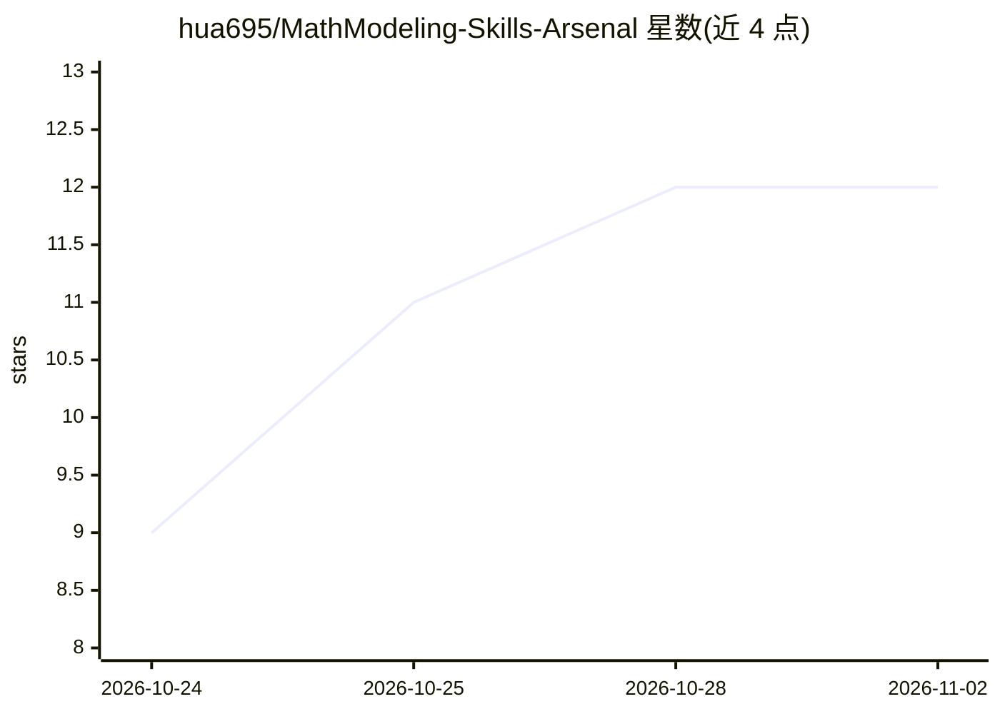

# hua695/MathModeling-Skills-Arsenal

⭐ 12 · Python · Apache-2.0 · 推送 2026-11-01 · [GitHub](https://github.com/hua695/MathModeling-Skills-Arsenal) · 个人维护 · 中文 README

**数学建模竞赛的 AI Agent 技能集，覆盖全流程**

面向 CUMCM/MCM/ICM 等数学建模竞赛的 35 个 AI Agent 技能（SKILL.md 格式），按主控流程、建模求解、论文写作、图表可视化、通用工具、元技能六类组织，附 12 个网文创作技能。核心 contest-orchestrator 技能串起题目解析、建模、求解、图表、论文成稿与评审，设阶段门禁与三级自主度。已适配 Claude Code / Codex / WorkBuddy / OpenCode 等宿主，核心流程仅依赖 Python 3.9 标准库。

## 筛选速览

| 维度 | 判定 | 备注 |
|---|---|---|
| AI 角色 | `ai-knowledge` | 知识聚合/清单类 |
| 许可风险 | `permissive` | Apache-2.0 |
| 部署形态 | `library` | 以包/库形式分发 |
| 模型依赖 | — | README 未给出锁定关系 |
| 硬件要求 | — | 无带数字的原话,不猜 |
| 安装摩擦 | `low` | 无编译、无系统依赖或容器化 |
| 成熟度 | — | 结构信号不足 |

## 能力要点

- 35 个技能按六类组织，覆盖读题到终稿评审全链路
- contest-orchestrator 主控流程支持 AUTO/COLLAB/LOCK 三级自主度与阶段门禁
- 适配 Claude Code / Codex / WorkBuddy / OpenCode 等 SKILL.md 宿主
- 核心主控流程仅依赖 Python 3.9+ 标准库

## 适用场景

- 为数学建模竞赛准备可流程化执行的 AI 技能集
- 让 Agent 按阶段推进建模、求解与论文写作
- 生成符合 CUMCM / MCM / ICM 格式要求的 LaTeX 论文与图表

## 场景标签

`提示工程` `AI 写作` · 领域:Agent 开发

## 证据(README 行号)

> L3: 面向数学建模竞赛的 AI Agent 技能集。三十五个技能，串起读题、建模求解、数据可视化、论文写作、终稿评审整条链路。
> L7: 已适配 Claude Code / Codex / WorkBuddy / OpenCode 等支持 `SKILL.md` 约定的宿主。

## 星数曲线

2026-10-24 9 → 2026-11-02 12（+3）

---
*卡片 v1 · prompt 1.4 · 生成 2026-11-01 · 置信度 mid · 依据 README sha `8fb535a1a48e` · [字段定义](../../DATASET.md)*
