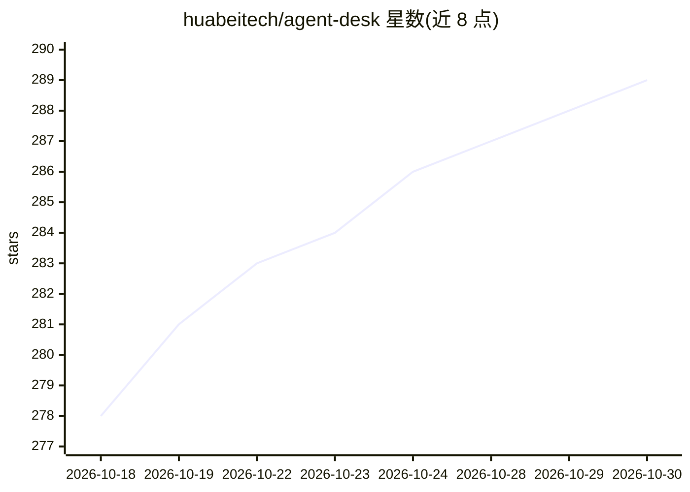

# huabeitech/agent-desk

⭐ 289 · Go · Apache-2.0 · 推送 2026-10-20 · [GitHub](https://github.com/huabeitech/agent-desk) · [官网](https://agent-desk.huabei.pro) · 组织维护 · 中文 README

**开源 AI 客服系统：AI 首答、知识库问答、人工接管与工单**

自托管的 AI Agent 客服系统，提供客户网页聊天、客服坐席工作台、知识库 RAG、工单流转与组织管理。AI Agent 基于检索知识先作答，Answerability Gate 判断检索内容是否足以回答，不足则回退并推荐人工支持，支持显式人工接管确认流程。模型接入采用 OpenAI 兼容协议，可配置 LLM、Embedding 与 Rerank 模型，运行时支持 Skills 与 MCP 扩展；存储支持 SQLite/MySQL 与 Qdrant 向量库。后端 Go，前端 Next.js，通过 Docker Compose 一键启动。

## 筛选速览

| 维度 | 判定 | 备注 |
|---|---|---|
| AI 角色 | `ai-native` | 本体是模型或模型工具 |
| 许可风险 | `permissive` | Apache-2.0 |
| 部署形态 | `self-host` | docker 或自建部署 |
| 模型依赖 | — | README 未给出锁定关系 |
| 硬件要求 | — | 无带数字的原话,不猜 |
| 安装摩擦 | `low` | 无编译、无系统依赖或容器化 |
| 成熟度 | — | 结构信号不足 |

## 能力要点

- AI Agent 首答 + Answerability Gate 判定可答性，不足时回退并转人工
- 知识库 RAG：文档、FAQ、分块、向量检索、检索日志与质量分析
- 会话转工单闭环：建单、分类、分派、状态流转与进度记录
- 支持 OpenAI 兼容模型配置、Skills 与 MCP 扩展

## 适用场景

- 网站在线客服与 SaaS 产品支持
- AI 与人工协作的混合客服
- 企业内部服务台或售后工单处理
- 需要知识库问答加人工接管的客服团队

## 场景标签

`聊天机器人` `文档问答` · 领域:对话与助手

## 证据(README 行号)

> L5: An open-source AI Agent customer support system with knowledge-based answers, human handoff, ticket workflows, and s
> L41: - **AI-first support**: Let AI Agents handle common questions, standard procedures, and knowledge-base answers firs
> L54: - **Answerability Gate**: Checks whether retrieved content can support an answer; otherwise returns a fallback and 

## 星数曲线

2026-10-18 278 → 2026-10-30 289（+11）

---
*卡片 v1 · prompt 1.4 · 生成 2026-10-22 · 置信度 mid · 依据 README sha `72f99fcdcd9a` · [字段定义](../../DATASET.md)*
