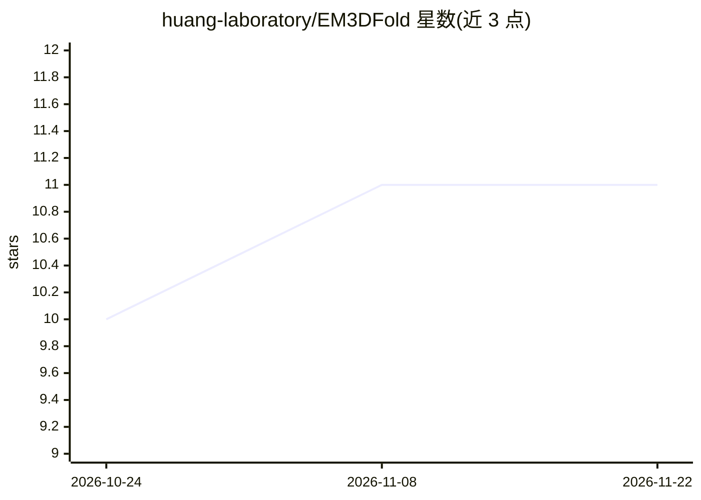

# huang-laboratory/EM3DFold

⭐ 11 · Python · 推送 2026-11-02 · [GitHub](https://github.com/huang-laboratory/EM3DFold) · 组织维护 · 中文 README

**从冷冻电镜密度图自动构建蛋白质/RNA/DNA原子结构模型**

EM3DFold 是一个从冷冻电镜密度图自动建模蛋白质、RNA、DNA 原子结构的软件包，支持有/无序列输入的 de novo 建模、蛋白-核酸复合物建模，以及通过 hmm_search 从序列数据库中识别图中的未知分子。面向冷冻电镜结构生物学研究者，安装方式为 git 源码下载加 Conda/Mamba 环境脚本，需下载预训练权重，仅支持 Linux（Windows 走 WSL），要求至少 12 GB VRAM 的 GPU 与 CUDA >= 11.8，权重与安装约需 10 GB 磁盘空间。

## 筛选速览

| 维度 | 判定 | 备注 |
|---|---|---|
| AI 角色 | `ai-native` | 本体是模型或模型工具 |
| 许可风险 | `none` | — |
| 部署形态 | `library` | 以包/库形式分发 |
| 模型依赖 | — | README 未给出锁定关系 |
| 硬件要求 | `gpu-8g` | |
| 安装摩擦 | `medium` | 含编译或系统依赖之一 |
| 成熟度 | — | 结构信号不足 |

## 能力要点

- 支持蛋白/RNA/DNA 及复合物的 de novo 建模与无序列建模
- hmm_search 子程序从序列数据库识别冷冻电镜图中的未知分子
- 提供 AI coding agent 安装 prompt 自动完成环境搭建与示例测试
- 多 GPU 支持（CA/C4' 预测与 de novo 阶段），权重经 SHA-256 校验

## 适用场景

- 拿到冷冻电镜密度图后直接生成原子结构模型
- 无已知序列时从密度图识别未知蛋白/核酸序列
- 对蛋白-核酸复合物做一体化建模
- 从 PDB/EMDB 下载样例数据复现建模流程

## 场景标签

`科研工具` · 领域:学习与行业

## 证据(README 行号)

> L5: EM3DFold: AI-driven Atomic Structure Modeling from Cryo-EM Maps
> L8: EM3DFold is a software package for automatic protein, RNA, and DNA structure modeling from cryo-EM density maps.
> L16: **GPU**: A GPU with at least 12 GB VRAM is required.
> L18: **CUDA**: CUDA >= 11.8 is required.

## 星数曲线

2026-10-24 10 → 2026-11-22 11（+1）

---
*卡片 v1 · prompt 1.4 · 生成 2026-11-18 · 置信度 high · 依据 README sha `b1330c2480ae` · [字段定义](../../DATASET.md)*
