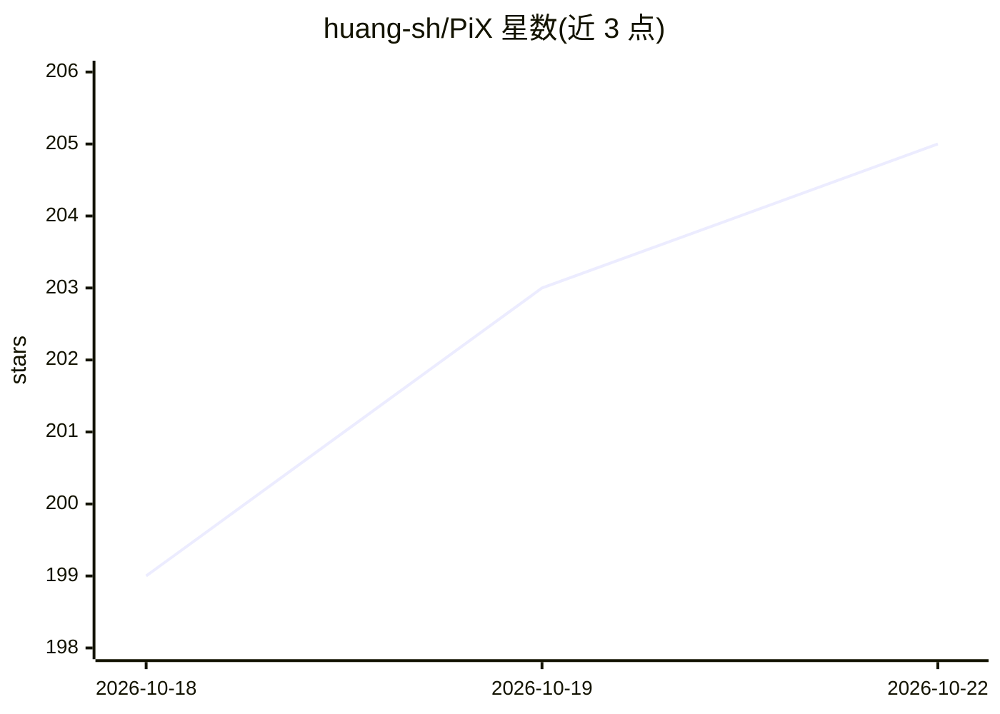

# huang-sh/PiX

⭐ 205 · TypeScript · MPL-2.0 · 推送 2026-10-18 · [GitHub](https://github.com/huang-sh/PiX) · 个人维护 · 中文 README

**非线性 AI agent 工作台：会话为图，可随时分支**

基于 Pi 1.2 的桌面 AI agent 工作台，将每次对话轮次组织为图上的节点，支持从任意消息分叉分支、从任一节点续聊、克隆当前分支作存档点，上下文随分支切换。内置 MCP、Codemode、工具搜索扩展，捆绑 FFF 文件搜索与跨平台桌面应用控制两个原生二进制扩展，可选安装 pi-web-access 网络访问扩展。会话保持 Pi 原生 JSONL 格式，可在 PiX 外继续使用。提供 Windows/macOS/Linux 安装包，也可用 Node.js 22.19+ 从源码运行。

## 筛选速览

| 维度 | 判定 | 备注 |
|---|---|---|
| AI 角色 | `ai-ecosystem` | LLM/agent 周边工具 |
| 许可风险 | `permissive` | MPL-2.0 |
| 部署形态 | `desktop` | 安装包/桌面程序 |
| 模型依赖 | locked-api |  |
| 硬件要求 | — | 无带数字的原话,不猜 |
| 安装摩擦 | `low` | 无编译、无系统依赖或容器化 |
| 成熟度 | — | 结构信号不足 |

## 能力要点

- 会话为图结构：任意节点可分叉、续聊、克隆分支，上下文随分支走
- 最多 3 个并排聊天面板对比不同分支
- 内置 MCP 与 Codemode 扩展，捆绑 FFF（Rust 原生文件/内容搜索）与桌面应用控制扩展
- 会话保持 Pi JSONL 原生格式，可在 PiX 外使用

## 适用场景

- 对 AI agent 的回答不满意时从该轮分叉换思路，保留原分支
- 并排对比多条分支的 agent 执行过程与结果
- 让 agent 观察并操作无 API 的桌面应用

## 场景标签

`AI 助手` `GUI 自动化` · 领域:效率与自动化

## 证据(README 行号)

> L5:  A non-linear AI agent workbench — sessions are graphs: branch anytime, and context follows the branch
> L45: PiX embeds Pi 1.2, including its MCP, Codemode and tool-search extensions. Existing Pi v3 JSONL sessions keep worki

## 星数曲线

2026-10-18 199 → 2026-10-22 205（+6）

---
*卡片 v1 · prompt 1.4 · 生成 2026-10-22 · 置信度 high · 依据 README sha `8202f034b990` · [字段定义](../../DATASET.md)*
