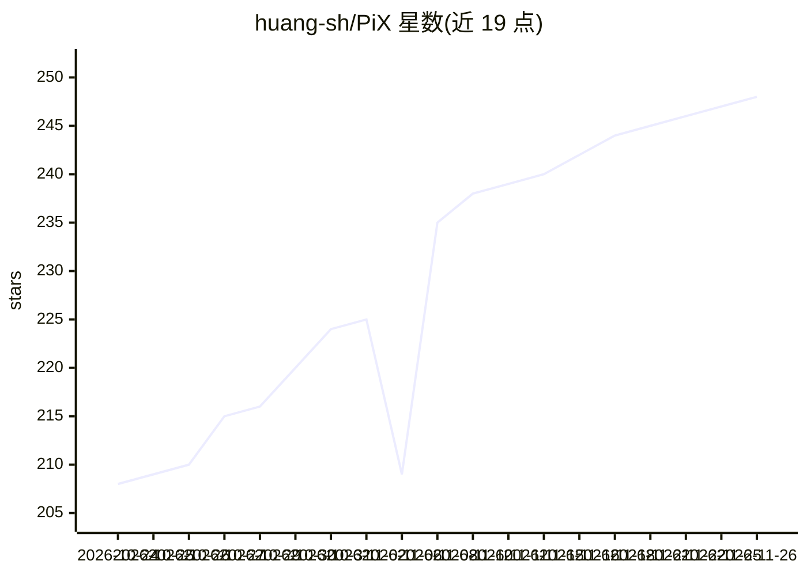

# huang-sh/PiX

⭐ 248 · TypeScript · MPL-2.0 · 推送 2026-11-15 · [GitHub](https://github.com/huang-sh/PiX) · 个人维护 · 中文 README

**非线性 AI agent 工作台：会话为树状图，可随时分支**

PiX 将 AI agent 会话组织为向右生长的图结构：每轮对话是节点，任意节点可分出新分支，分支间上下文相互独立，切换分支无需重新配置。桌面端提供最多三列并排聊天面板比较分支，内嵌 Pi 1.5 及其 MCP、Codemode、tool-search 扩展，兼容既有 Pi v3 JSONL 会话。随安装包附带 FFF 文件搜索与桌面应用控制扩展，CLI 命令与 GUI 共享会话树与后台主机。Windows/macOS/Linux 提供安装包，安装包未签名。

## 筛选速览

| 维度 | 判定 | 备注 |
|---|---|---|
| AI 角色 | `ai-ecosystem` | LLM/agent 周边工具 |
| 许可风险 | `permissive` | MPL-2.0 |
| 部署形态 | `desktop` | 安装包/桌面程序 |
| 模型依赖 | — | README 未给出锁定关系 |
| 硬件要求 | — | 无带数字的原话,不猜 |
| 安装摩擦 | `low` | 无编译、无系统依赖或容器化 |
| 成熟度 | — | 结构信号不足 |

## 能力要点

- 会话组织为图结构：每轮对话为节点，任意节点可分支
- 分支自带上下文，支持最多三列并排聊天面板比较分支
- 内嵌 Pi 1.5 的 MCP、Codemode、tool-search 扩展，兼容 Pi v3 JSONL 会话
- 桌面安装包附带 FFF 文件搜索（Rust/SIMD）与桌面应用控制扩展

## 适用场景

- 对同一问题尝试不同提示词并保留各分支对比
- 从任意历史节点继续对话而不破坏原分支
- 在终端与桌面端之间共享并并发运行 agent 会话分支

## 场景标签

`AI 助手` · 领域:对话与助手

## 证据(README 行号)

> L5:  A non-linear AI agent workbench — sessions are graphs: branch anytime, and context follows the branch
> L11: A PiX session is not a line — it is a graph that keeps growing: every conversation turn is a node, and any node can
> L45: PiX embeds Pi 1.5, including its MCP, Codemode and tool-search extensions. Existing Pi v3 JSONL sessions keep worki

## 星数曲线

2026-10-24 208 → 2026-11-26 248（+40）

---
*卡片 v1 · prompt 1.4 · 生成 2026-11-25 · 置信度 high · 依据 README sha `6872cd24a019` · [字段定义](../../DATASET.md)*
