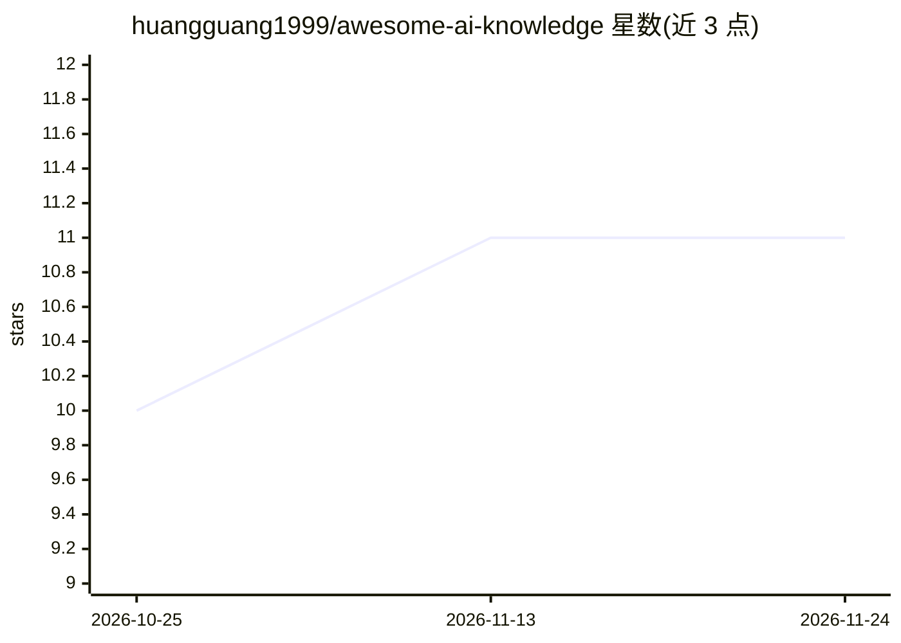

# huangguang1999/awesome-ai-knowledge

⭐ 11 · Python · MIT · 推送 2026-05-28 · [GitHub](https://github.com/huangguang1999/awesome-ai-knowledge) · 个人维护 · 中文 README

**零基础读者的 AI 面试题大白话讲解库（100 题 11 方向）**

整理真实高频 AI 面试题并以零基础标准重写的知识库：覆盖大模型基础、Agent、RAG、评估、Prompt 工程、微调对齐、工具调用与 MCP、部署推理优化、向量 Embedding、多模态、应用安全共 11 个方向、100 题。每题固定四段结构（一句话先懂、生活化类比、答题要点、进阶线索）。题目整理自 datawhalechina/hello-agents 等开源题库，讲解由 Claude 辅助生成并声明可能有误，MIT 许可。

## 筛选速览

| 维度 | 判定 | 备注 |
|---|---|---|
| AI 角色 | `ai-knowledge` | 知识聚合/清单类 |
| 许可风险 | `permissive` | MIT |
| 部署形态 | `None` |  |
| 模型依赖 | — | README 未给出锁定关系 |
| 硬件要求 | — | 无带数字的原话,不猜 |
| 安装摩擦 | `low` | 无编译、无系统依赖或容器化 |
| 成熟度 | — | 结构信号不足 |

## 能力要点

- 100 道面试题按 11 个方向组织，标注来源
- 每题四段固定结构：一句话、类比、答题要点、进阶线索
- 面向零基础读者，术语随文解释
- README 声明讲解由 AI 辅助生成并提示核实

## 适用场景

- 转行或入门者快速建立大模型/Agent/RAG 的概念直觉
- 面试前用大白话复习 AI 八股题
- 查找某类面试题及其通俗解释

## 场景标签

`教程课程` · 领域:学习与行业

## 证据(README 行号)

> L3: > **AI 面试八股,但讲成人话。** 真实高频面试题 + 零基础也能看懂的大白话讲解。
> L19: ## 目录(100 题 · 11 个方向)
> L62: 每道题的大白话讲解由 **AI(Claude)辅助生成**,再按统一的"零基础"标准组织。

## 星数曲线

2026-10-25 10 → 2026-11-24 11（+1）

---
*卡片 v1 · prompt 1.4 · 生成 2026-11-18 · 置信度 high · 依据 README sha `474bf8c32232` · [字段定义](../../DATASET.md)*
