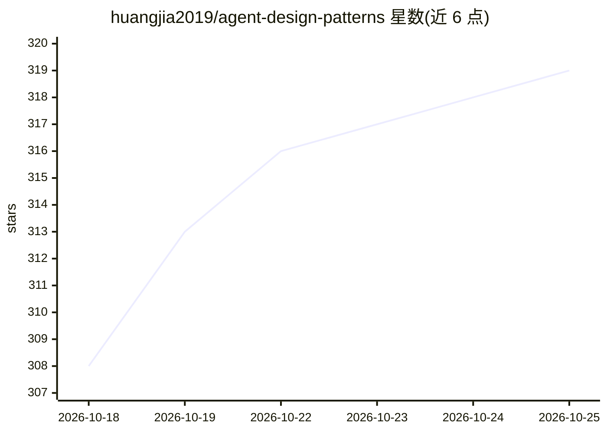

# huangjia2019/agent-design-patterns

⭐ 319 · HTML · MIT · 推送 2026-10-11 · [GitHub](https://github.com/huangjia2019/agent-design-patterns) · 个人维护 · 中文 README

**AI agent 设计模式参考目录：27 模式按 7×6 矩阵定位，附可运行代码**

面向 agent 开发者与架构师的设计模式参考库：以认知功能×执行拓扑两轴框架组织 27 个核心模式，每个模式目录含最小参考实现 pattern.py、无需 API key 即可运行的 example.py、测试与中英双语 README。每个模式的 README 引用 Claude Code、Aider、OpenHands 等生产级项目的文件行级工程切片。明确声明本仓库不是框架，需配合 LangGraph 等运行时使用。是 Manning 图书 Designing AI Agents 与 arXiv 论文的配套代码库。

## 筛选速览

| 维度 | 判定 | 备注 |
|---|---|---|
| AI 角色 | `ai-knowledge` | 知识聚合/清单类 |
| 许可风险 | `permissive` | MIT |
| 部署形态 | `None` |  |
| 模型依赖 | — | README 未给出锁定关系 |
| 硬件要求 | — | 无带数字的原话,不猜 |
| 安装摩擦 | `low` | 无编译、无系统依赖或容器化 |
| 成熟度 | — | 结构信号不足 |

## 能力要点

- 27 个核心模式按认知功能×执行拓扑两轴矩阵定位
- 每个模式含可运行 pattern.py / example.py / 测试，example 无需 API key
- 工程切片引用 Claude Code、Aider、OpenHands 等项目的文件行级代码
- 配套 arXiv 论文与 Manning 图书，中英双语文档

## 适用场景

- 为 agent 设计问题定位应选用的模式及其坐标
- 学习各模式在生产级 agent 项目中的真实实现方式
- 配合图书/论文做可运行的代码参考

## 场景标签

`精选清单` · 领域:学习与行业

## 证据(README 行号)

> L1: # Agent Design Patterns
> L3: Reference code and editable ADPS documentation for agent architecture: 27 core patterns, extension patterns, and thr
> L65: The current public framework places 27 core patterns in the seven-by-six

## 星数曲线

2026-10-18 308 → 2026-10-25 319（+11）

---
*卡片 v1 · prompt 1.4 · 生成 2026-10-22 · 置信度 high · 依据 README sha `ebe377c546a2` · [字段定义](../../DATASET.md)*
