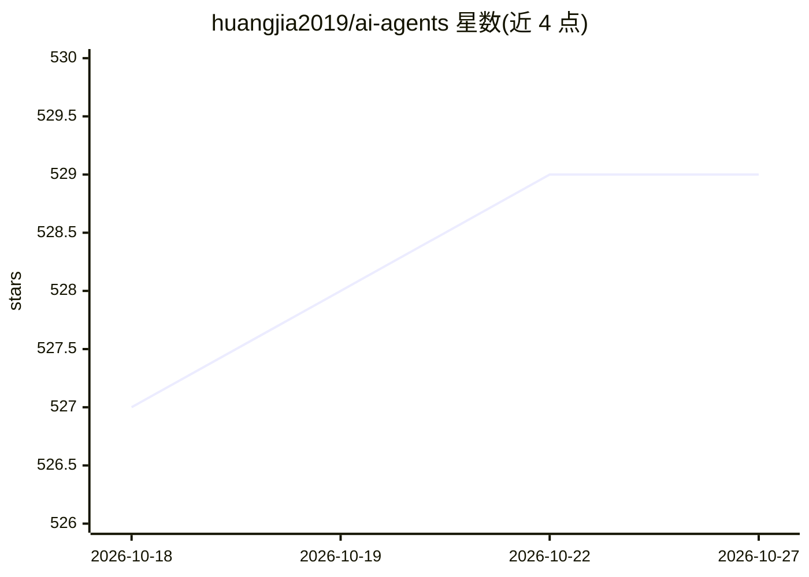

# huangjia2019/ai-agents

⭐ 529 · Jupyter Notebook · 推送 2025-11-05 · [GitHub](https://github.com/huangjia2019/ai-agents) · [官网](https://item.jd.com/14600442.html) · 个人维护 · 中文 README

**《动手做AI Agent》等图书配套的入门示例代码仓库**

异步图书《大模型应用开发 动手做AI Agent》的配套代码仓库，提供面向新手的 LLM Agent 构建入门示例。README 主要为图书推介页，列出《GPT图解》《动手做Agent》《机器学习》《数据分析》等书籍及购书链接，并说明本书为提纲挈挈领性质，更多示例可参考 OpenAI Cookbook 与 LangChain Example。仓库本身未展示具体代码结构与运行方式。

## 筛选速览

| 维度 | 判定 | 备注 |
|---|---|---|
| AI 角色 | `ai-knowledge` | 知识聚合/清单类 |
| 许可风险 | `none` | — |
| 部署形态 | `None` |  |
| 模型依赖 | — | README 未给出锁定关系 |
| 硬件要求 | — | 无带数字的原话,不猜 |
| 安装摩擦 | `low` | 无编译、无系统依赖或容器化 |
| 成熟度 | — | 结构信号不足 |

## 能力要点

- 面向新手的 LLM Agent 入门示例代码
- 配套异步图书《大模型应用开发 动手做AI Agent》
- README 引导读者到 OpenAI Cookbook 与 LangChain Example 深入学习

## 适用场景

- 跟随《动手做AI Agent》图书入门 LLM Agent 开发
- 新手了解大模型应用开发的基础路径

## 场景标签

`教程课程` · 领域:学习与行业

## 证据(README 行号)

> L1: # 大模型应用开发 动手做AI Agent
> L14: ## 动手做Agent
> L16: 说明：这本书指导读者如何从零开始动手制作AI Agent。

## 星数曲线

2026-10-18 527 → 2026-10-27 529（+2）

---
*卡片 v1 · prompt 1.4 · 生成 2026-10-21 · 置信度 mid · 依据 README sha `c08668e1d3cb` · [字段定义](../../DATASET.md)*
