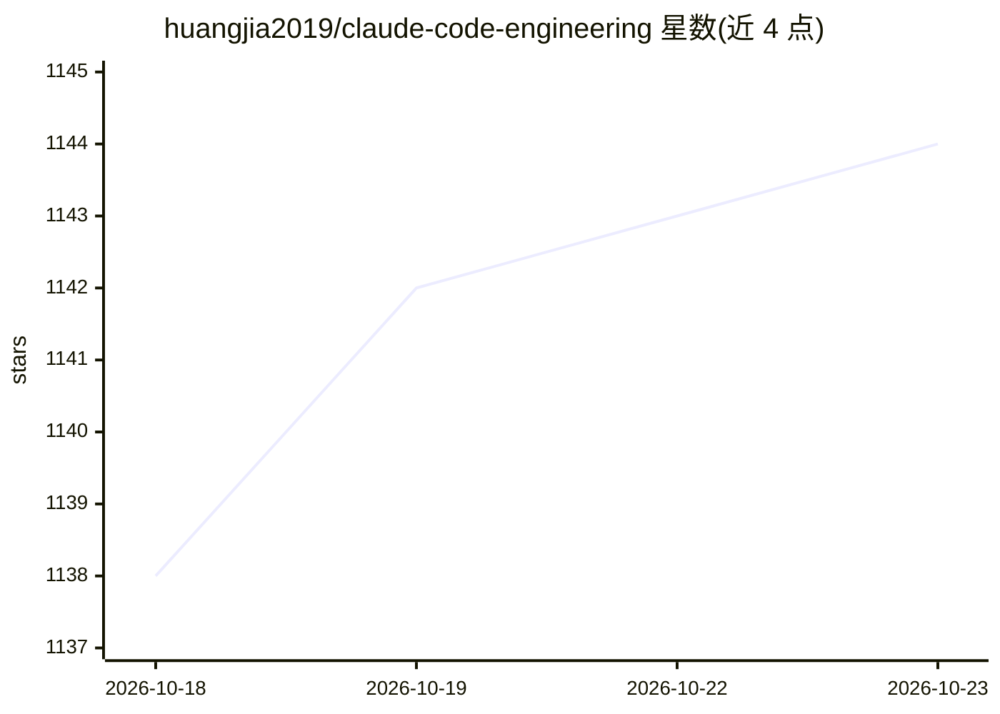

# huangjia2019/claude-code-engineering

⭐ 1,144 · JavaScript · 推送 2026-07-23 · [GitHub](https://github.com/huangjia2019/claude-code-engineering) · [官网](https://time.geekbang.org/column/intro/101113501) · 个人维护 · 中文 README

**Claude Code 工程化课程的配套示例与代码仓库**

极客时间专栏《Claude Code 工程化实战》的官方配套仓库：以 23 讲课程大纲为主线，覆盖 CLAUDE.md 记忆、Sub-Agents、Skills、Hooks、MCP、Headless/CI-CD、Rules、Agent SDK 与 Plugins 等主题，每讲配 projects/ 子目录下可运行项目；另含《Claude Code 实战》一书 10 章共 226 个代码片段（99-书籍代码/ 目录）。README 同时列出作者的其他书与专栏。面向已在使用 Claude Code、想系统化掌握其工程机制的开发者。

## 筛选速览

| 维度 | 判定 | 备注 |
|---|---|---|
| AI 角色 | `ai-knowledge` | 知识聚合/清单类 |
| 许可风险 | `none` | — |
| 部署形态 | `None` |  |
| 模型依赖 | — | README 未给出锁定关系 |
| 硬件要求 | — | 无带数字的原话,不猜 |
| 安装摩擦 | `low` | 无编译、无系统依赖或容器化 |
| 成熟度 | — | 结构信号不足 |

## 能力要点

- 23 讲课程大纲覆盖记忆/SubAgent/Skills/Hooks/MCP/SDK/Plugins
- 每讲配 projects/ 可运行项目
- 书籍配套 226 个代码片段按章节归类

## 适用场景

- 跟随课程实战学习 Claude Code 各机制
- 按章节查找可直接运行的示例项目
- 对照书籍代码片段理解实现细节

## 场景标签

`教程课程` · 领域:学习与行业

## 证据(README 行号)

> L72: 🎯 **这是我为极客时间2026年制作的最新专栏，目标：快速掌握 Claude Code 高阶技能，进行工程化的 Agent 实战**
> L164: 《Claude Code 实战》全书 10 章的代码片段已整理到本仓库的 **`99-书籍代码/`** 目录——每章一个子文件夹，按章节内出现顺序编号，可直接 copy-paste。

## 星数曲线

2026-10-18 1,138 → 2026-10-23 1,144（+6）

---
*卡片 v1 · prompt 1.4 · 生成 2026-10-21 · 置信度 high · 依据 README sha `91d879654921` · [字段定义](../../DATASET.md)*
