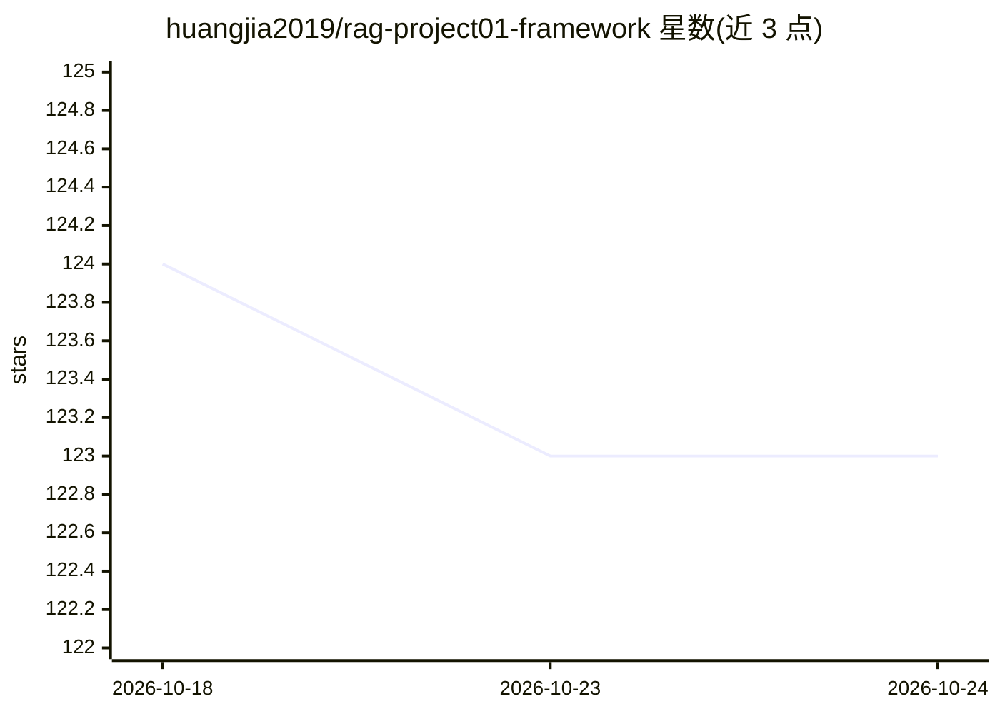

# huangjia2019/rag-project01-framework

⭐ — · [GitHub]() · 个人维护 · 中文 README

**从零手写的 RAG 知识库问答系统，含前后端**

不依赖 LangChain 等现有 RAG 框架、从零实现文档分块、向量化存储（Milvus）与相似度检索的知识库问答系统，配套 React+Vite 前端与 FastAPI 后端。面向学习 RAG 各环节的教学场景（作者为极客时间 RAG 训练营学员，用 Cursor 制作）。安装涉及 git clone、npm、pip、conda、HuggingFace 本地模型与 OpenAI/DeepSeek API Key 配置，Windows 下 Milvus 需 docker 或换 Chroma 分支。

## 筛选速览

| 维度 | 判定 | 备注 |
|---|---|---|
| AI 角色 | `ai-native` | 本体是模型或模型工具 |
| 许可风险 | `none` | — |
| 部署形态 | `library` | 以包/库形式分发 |
| 模型依赖 | locked-api |  |
| 硬件要求 | — | 无带数字的原话,不猜 |
| 安装摩擦 | `low` | 无编译、无系统依赖或容器化 |
| 成熟度 | — | 结构信号不足 |

## 能力要点

- 分块/向量化/检索核心模块完全自主实现，无 RAG 框架依赖
- 向量数据库使用 Milvus（Windows 可换 Chroma 分支）
- 支持 HuggingFace 本地嵌入模型（HF_MODEL_PATH、hf-mirror 镜像）
- 提供 Ubuntu/macOS/Windows 三平台部署说明

## 适用场景

- 学习 RAG 各环节的实现细节并自行定制
- 搭建轻量级个人/团队知识库问答系统
- 对照现有 RAG 框架理解分块、检索与生成流程

## 场景标签

`RAG` `文档问答` `教程课程` · 领域:知识与检索

## 证据(README 行号)

> L5: 一个从零开始实现的 RAG (Retrieval Augmented Generation) 系统，不依赖现有的 RAG 框架。该项目旨在提供一个轻量级、可定制的知识库问答解决方案。
> L10: 本项目是一个完全自主实现的 RAG 系统，通过将文档分块、向量化存储、相似度检索等核心功能模块化实现，使用户能够构建自己的知识库问答系统。
> L14: - 文档分块：支持自定义大小的文档分块策略

## 星数曲线

2026-10-18 124 → 2026-10-24 123（-1）

---
*卡片 v1 · prompt 1.4 · 生成 2026-10-23 · 置信度 mid · 依据 README sha `e8b5c640c237` · [字段定义](../../DATASET.md)*
