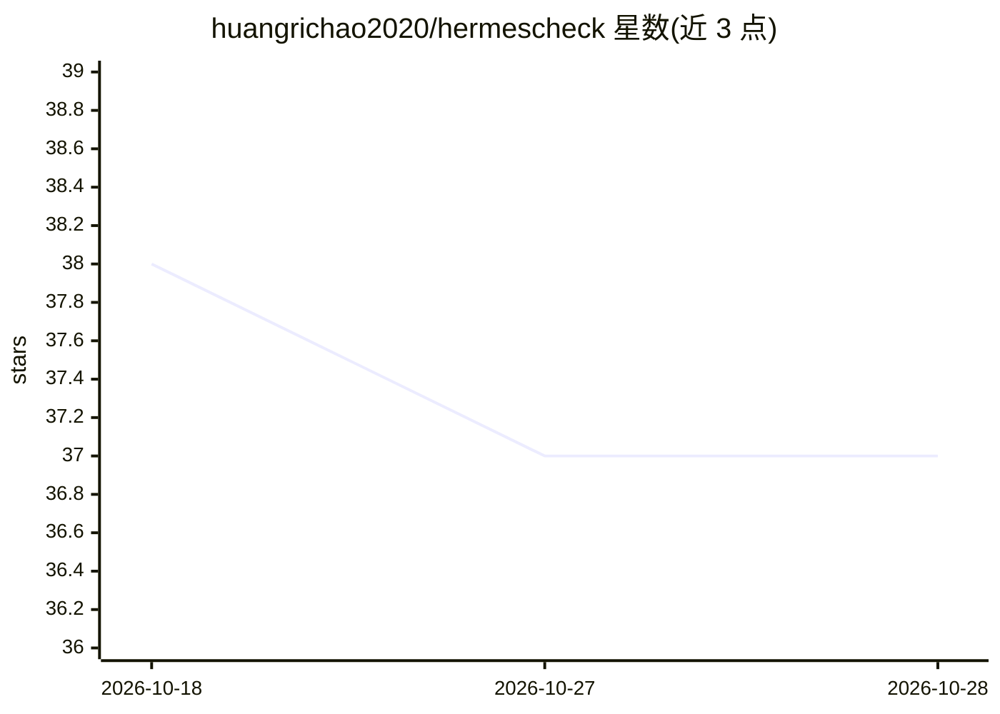

# huangrichao2020/hermescheck

⭐ 37 · Python · MIT · 推送 2026-05-16 · [GitHub](https://github.com/huangrichao2020/hermescheck) · 个人维护 · 中文 README

**面向 Hermes Agent 的架构与运行时健康静态审计工具**

hermescheck 是一个 Python CLI 工具，扫描 AI agent 代码库（首个深度适配目标为 NousResearch/hermes-agent），生成结构化架构报告，检查记忆漂移、工具边界缺口、运行时蔓延、网关风险、调度器行为、可观测性等长时运行 agent 失效模式。提供 personal/enterprise 两种扫描档位，输出 JSON/Markdown/SARIF 及 PNG 报告卡；由通用扫描器 agchk 派生并收窄到 Hermes 工作流，非官方 Nous Research 项目。通过 pip 安装。

## 筛选速览

| 维度 | 判定 | 备注 |
|---|---|---|
| AI 角色 | `ai-ecosystem` | LLM/agent 周边工具 |
| 许可风险 | `permissive` | MIT |
| 部署形态 | `library` | 以包/库形式分发 |
| 模型依赖 | — | README 未给出锁定关系 |
| 硬件要求 | — | 无带数字的原话,不猜 |
| 安装摩擦 | `low` | 无编译、无系统依赖或容器化 |
| 成熟度 | — | 结构信号不足 |

## 能力要点

- 检测 Hermes 核心运行时表面（agent loop、CLI、网关、skills、cron、SessionDB 等）是否完整
- 检查 slash 命令跨表面共享契约与命令注册表一致性
- 输出 JSON/Markdown/SARIF 报告与 PNG 报告卡，含 maturity_score 与 ordered_fix_plan
- personal/enterprise 两种扫描档位，支持 --fail-on 阈值

## 适用场景

- Hermes Agent fork 或部署在发布前做架构健康检查
- 为 Hermes PR 提供可引用的验证命令与审计证据
- 团队生产部署检查密钥、代码执行、审批与可观测性风险

## 场景标签

 · 领域:AI agent 工程化/审计工具

## 证据(README 行号)

> L9: `hermescheck` scans an AI agent checkout and produces a structured architecture
> L15: Hermes Agent remains the first deep adaptation target. `hermescheck` is a

## 星数曲线

2026-10-18 38 → 2026-10-28 37（-1）

---
*卡片 v1 · prompt 1.4 · 生成 2026-10-25 · 置信度 high · 依据 README sha `3c2406467ae8` · [字段定义](../../DATASET.md)*
