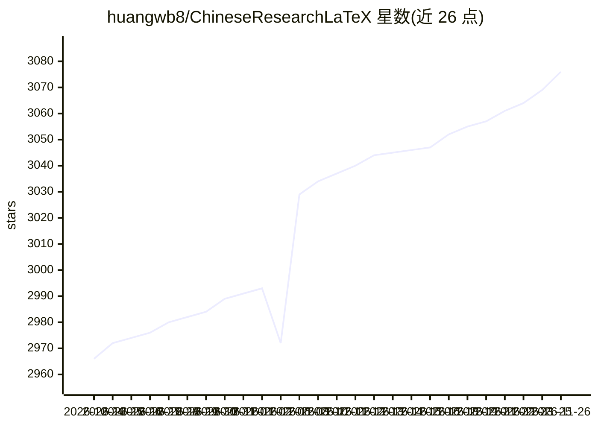

# huangwb8/ChineseResearchLaTeX

⭐ 3,076 · Python · MIT · 推送 2026-11-24 · [GitHub](https://github.com/huangwb8/ChineseResearchLaTeX) · 个人维护 · 中文 README

**为中国科研者提供 AI 辅助的国自然/论文/简历 LaTeX 模板集**

面向中国科研人群的 LaTeX 模板集合，覆盖国自然（青年/面上/地区）、广东与广西省自然科学基金、SCI 论文、十余所高校学位论文/博士后及中英文学术简历模板，提供标准 zip 与 Overleaf 专用包下载。项目按 Vibe Coding 理念构建 Agent Skills 体系，内置约 25 个技能（文献调研、标书写作、SCI 论文写作、模板开发），通过 Claude Code / Codex CLI 等以 Prompt 驱动安装、编译与写作。编译需 XeLaTeX，依赖 Python 3，本地推荐 VS Code + LaTeX Workshop；未配置 AI 环境可走手动配置指南。MIT 许可，另有 Gitee 镜像。

## 筛选速览

| 维度 | 判定 | 备注 |
|---|---|---|
| AI 角色 | `ai-enhanced` | 去掉 AI 部分产品仍成立 |
| 许可风险 | `permissive` | MIT |
| 部署形态 | `None` |  |
| 模型依赖 | — | README 未给出锁定关系 |
| 硬件要求 | — | 无带数字的原话,不猜 |
| 安装摩擦 | `low` | 无编译、无系统依赖或容器化 |
| 成熟度 | — | 结构信号不足 |

## 能力要点

- 覆盖 NSFC、省级基金、SCI、学位论文、简历等中文科研文档模板，提供 Overleaf 包
- 内置约 25 个 AI Skills：文献检索/综述、NSFC 摘要与立项依据写作、标书 QC 等
- 通过 Prompt 在 Claude Code/Codex 中自动安装 LaTeX 包、Skills 并触发编译
- 支持 PDF/DOCX 双输出与像素级验收脚本

## 适用场景

- 下载国自然青年/面上标书 LaTeX 模板撰写申请书
- 用 AI Skills 生成 NSFC 中英文摘要与立项依据初稿
- 按学校规范撰写硕士/博士毕业论文 LaTeX 稿
- 在 Overleaf 上编译中国科研文档模板

## 场景标签

`科研工具` `AI 写作` · 领域:内容生成

## 证据(README 行号)

> L3: # 中国科研常用 LaTeX 模板集
> L38: - 🤖 **AI 驱动**：智能模板规划、自动样式对齐、代码审查测试
> L41: - 🔬 **科研导向**：专为国自然标书、SCI 论文、毕业论文、学术简历等科研文档场景深度优化

## 星数曲线

2026-10-24 2,966 → 2026-11-26 3,076（+110）

---
*卡片 v1 · prompt 1.4 · 生成 2026-11-26 · 置信度 high · 依据 README sha `466de81b15f1` · [字段定义](../../DATASET.md)*
