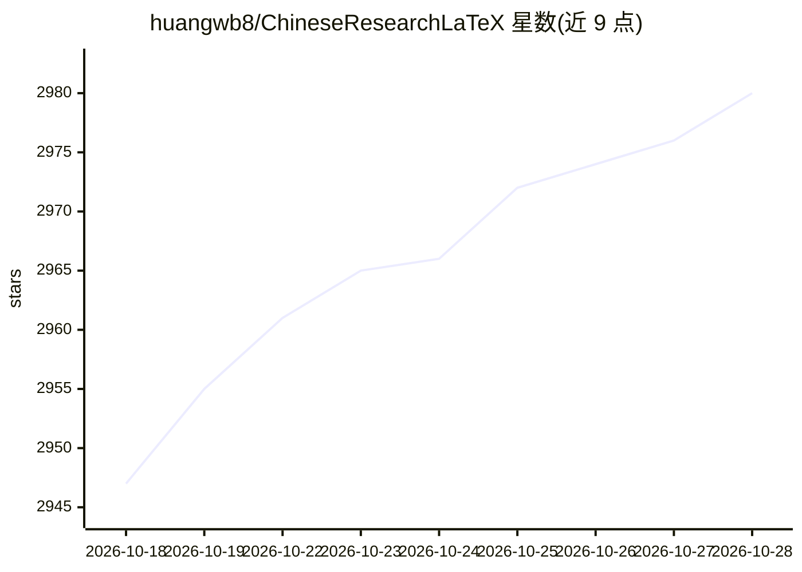

# huangwb8/ChineseResearchLaTeX

⭐ 2,980 · Python · MIT · 推送 2026-10-17 · [GitHub](https://github.com/huangwb8/ChineseResearchLaTeX) · 个人维护 · 中文 README

**面向中国科研者的 LaTeX 模板集与配套 AI 写作技能库**

收录国自然（NSFC）、广东省/广西基金、SCI 论文、多校学位论文与学术简历等 LaTeX 模板，提供标准 zip 与 Overleaf 专用包下载，编译须用 XeLaTeX。项目同时内置 20 余个 AI Agent 技能（Skills），覆盖文献调研、NSFC 标书写作、SCI 论文写作、模板迁移等场景，兼容 Claude Code、OpenAI Codex CLI、Cursor、GitHub Actions 与 VS Code；包安装、模板编译与技能安装均可通过向 AI 助手输入 Prompt 由其自动调用官方脚本完成，也提供手动指南。使用需自备 AI 算力。

## 筛选速览

| 维度 | 判定 | 备注 |
|---|---|---|
| AI 角色 | `ai-ecosystem` | LLM/agent 周边工具 |
| 许可风险 | `permissive` | MIT |
| 部署形态 | `None` |  |
| 模型依赖 | — | README 未给出锁定关系 |
| 硬件要求 | — | 无带数字的原话,不猜 |
| 安装摩擦 | `low` | 无编译、无系统依赖或容器化 |
| 成熟度 | — | 结构信号不足 |

## 能力要点

- NSFC/省级基金/SCI/学位论文/简历多线 LaTeX 模板，标准包与 Overleaf 包分发
- 20+ 个 AI 技能：文献调研（检索/综述/引用核查）、NSFC 标书写作与多专家评审模拟、SCI 论文写作等
- 兼容 Claude Code、OpenAI Codex CLI、Cursor、GitHub Actions、VS Code 五种运行环境
- LaTeX 公共包（fonts/nsfc/paper/thesis/cv）可独立安装，模板列表由 GitHub Actions 每小时自动检查

## 适用场景

- 用国自然或省级基金模板撰写申报标书，并用 AI 技能生成摘要、编排名额与模拟评审
- 按学校规范选用学位论文模板并输出 PDF/DOCX
- 借助文献调研技能做多源检索、综述与引用一致性检查
- 在 Claude Code / Codex CLI 中让 AI 自动完成模板编译与包安装

## 场景标签

`科研工具` `AI 写作` · 领域:内容生成

## 证据(README 行号)

> L210: 项目内置多个符合 我预定义规范 的强大 Skills，辅助 LaTeX 写作和模板优化。**兼容 Claude Code、OpenAI Codex、Cursor、GitHub Actions、VS Code！** 通过灵活运用 
> L156: - **Claude Code / OpenAI Codex CLI**（VS Code 插件）：**最佳选择**，AI 辅助写作，与本项目的 AI 技能完美配合。VS Code 扩展市场搜索"Claude Code"或"Ope
> L183: 在 **Claude Code** 或 **OpenAI Codex** 中输入以下 Prompt

## 星数曲线

2026-10-18 2,947 → 2026-10-28 2,980（+33）

---
*卡片 v1 · prompt 1.4 · 生成 2026-10-21 · 置信度 high · 依据 README sha `873f1b3a3837` · [字段定义](../../DATASET.md)*
