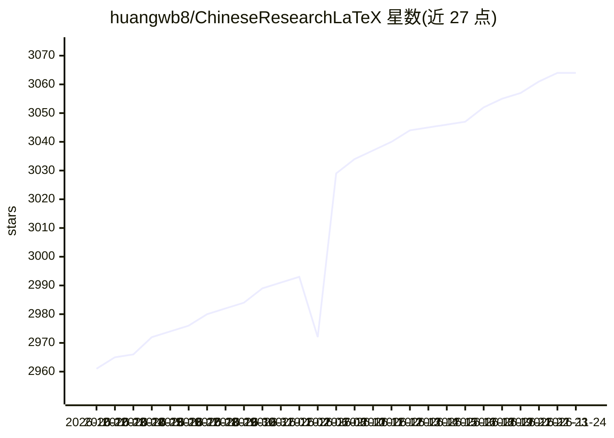

# huangwb8/ChineseResearchLaTeX

⭐ 3,069 · Python · MIT · 推送 2026-11-15 · [GitHub](https://github.com/huangwb8/ChineseResearchLaTeX) · 个人维护 · 中文 README

**面向中国科研者的LaTeX模板集与AI写作技能体系**

提供国自然（青年/面上/地区）、省级自然科学基金、SCI 论文、多所高校学位论文/博士后与学术简历的 LaTeX 模板，以 zip 下载包与 Overleaf 包形式分发。项目按 Vibe Coding 理念构建可扩展的 Agent Skills 体系，内置 30 余个技能，覆盖文献调研、标书写作、SCI 论文写作与模板开发，兼容 Claude Code、OpenAI Codex、Cursor 等工具。运行需 TeX Live/MacTeX 与 XeLaTeX 编译器，依赖 Python 3 环境；提供中英 PDF/DOCX 双输出与字数统计构建脚本。

## 筛选速览

| 维度 | 判定 | 备注 |
|---|---|---|
| AI 角色 | `ai-native` | 本体是模型或模型工具 |
| 许可风险 | `permissive` | MIT |
| 部署形态 | `None` |  |
| 模型依赖 | — | README 未给出锁定关系 |
| 硬件要求 | — | 无带数字的原话,不猜 |
| 安装摩擦 | `low` | 无编译、无系统依赖或容器化 |
| 成熟度 | — | 结构信号不足 |

## 能力要点

- 覆盖 NSFC、省级基金、SCI 论文、高校学位论文与学术简历的 LaTeX 模板集
- 内置 30 余个 Agent Skills，涵盖文献检索、综述、标书写作、模板迁移等场景
- 兼容 Claude Code、OpenAI Codex、Cursor、GitHub Actions、VS Code
- 支持 PDF/DOCX 双输出与像素级验收脚本，提供标准包与 Overleaf 包

## 适用场景

- 用 LaTeX 撰写国自然标书并让 AI 辅助生成摘要与研究内容
- 按学校规范定制毕业论文模板并自动编译 PDF
- 做多源文献检索、去重与综述写作
- 制作中英文学术简历

## 场景标签

`科研工具` `AI 写作` · 领域:内容生成

## 证据(README 行号)

> L10:  🤝 打造最适合中国研究者的科研文档 AI Agent，让天下没有难写的国自然标书、SCI 论文、毕业论文、学术简历！🚀
> L39: - 🧩 **模块化技能**：可扩展的 AI 技能体系，支持灵活组合与升级
> L41: - 🔬 **科研导向**：专为国自然标书、SCI 论文、毕业论文、学术简历等科研文档场景深度优化

## 星数曲线

2026-10-22 2,961 → 2026-11-24 3,064（+103）

---
*卡片 v1 · prompt 1.4 · 生成 2026-11-23 · 置信度 high · 依据 README sha `86efe01e4bf1` · [字段定义](../../DATASET.md)*
