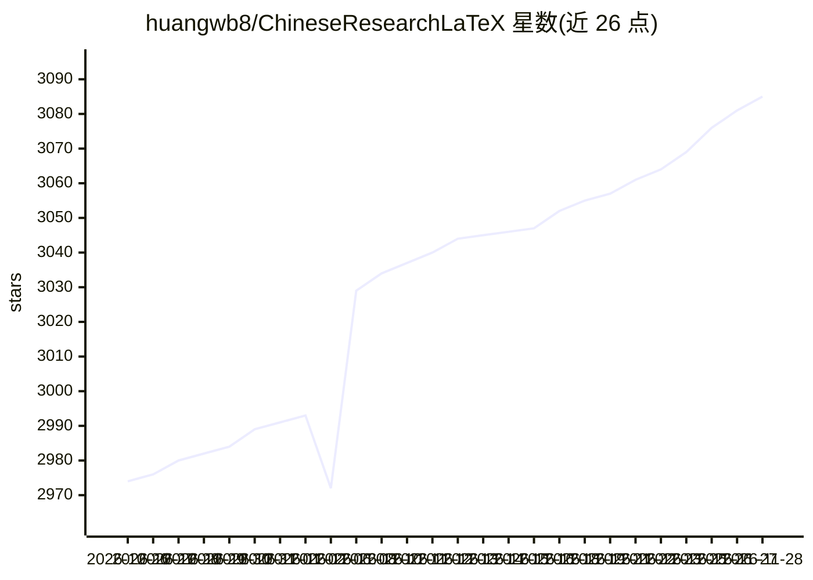

# huangwb8/ChineseResearchLaTeX

⭐ 3,085 · Python · MIT · 推送 2026-11-26 · [GitHub](https://github.com/huangwb8/ChineseResearchLaTeX) · 个人维护 · 中文 README

**为中国科研者提供 AI 辅助的国自然/SCI/学位论文 LaTeX 模板与技能集**

面向中国研究者的 LaTeX 模板集合，覆盖国自然标书（青年/面上/地区）、省区自然科学基金、SCI 论文、16 所院校的学位论文/博士后模板及学术简历，提供标准包与 Overleaf 包下载。项目基于 Vibe Coding 理念，内置约 28 个 Agent Skills（文献调研、标书写作、论文写作、模板开发），需在 Claude Code 或 OpenAI Codex 中以 Prompt 方式安装和调用；编译须使用 XeLaTeX（xelatex→bibtex→xelatex→xelatex），依赖 Python 3 与 TeX Live/MacTeX。

## 筛选速览

| 维度 | 判定 | 备注 |
|---|---|---|
| AI 角色 | `ai-native` | 本体是模型或模型工具 |
| 许可风险 | `permissive` | MIT |
| 部署形态 | `None` |  |
| 模型依赖 | — | README 未给出锁定关系 |
| 硬件要求 | — | 无带数字的原话,不猜 |
| 安装摩擦 | `low` | 无编译、无系统依赖或容器化 |
| 成熟度 | — | 结构信号不足 |

## 能力要点

- NSFC、省区基金、SCI、学位论文、简历等多类 LaTeX 模板与下载包
- 约 28 个 AI Skills 覆盖文献调研、标书写作、SCI 论文与模板开发
- 支持 PDF / DOCX 双输出的论文公共包与像素级验收脚本
- 提供 Gitee 镜像与 Overleaf 包分发

## 适用场景

- 撰写国自然标书并用 AI 生成摘要、立项依据等章节
- 用院校学位论文模板排版毕业论文
- 维护中英双语学术简历
- 用 AI 技能做文献检索与综述写作

## 场景标签

`科研工具` `AI 写作` · 领域:内容生成

## 证据(README 行号)

> L10:  🤝 打造最适合中国研究者的科研文档 AI Agent，让天下没有难写的国自然标书、SCI 论文、毕业论文、学术简历！🚀
> L41: - 🔬 **科研导向**：专为国自然标书、SCI 论文、毕业论文、学术简历等科研文档场景深度优化
> L212: 项目内置多个符合 我预定义规范 的强大 Skills，辅助 LaTeX 写作和模板优化。**兼容 Claude Code、OpenAI Codex、Cursor、GitHub Actions、VS Code！** 通过灵活运用 

## 星数曲线

2026-10-26 2,974 → 2026-11-28 3,085（+111）

---
*卡片 v1 · prompt 1.4 · 生成 2026-11-27 · 置信度 high · 依据 README sha `55af3ce643ff` · [字段定义](../../DATASET.md)*
