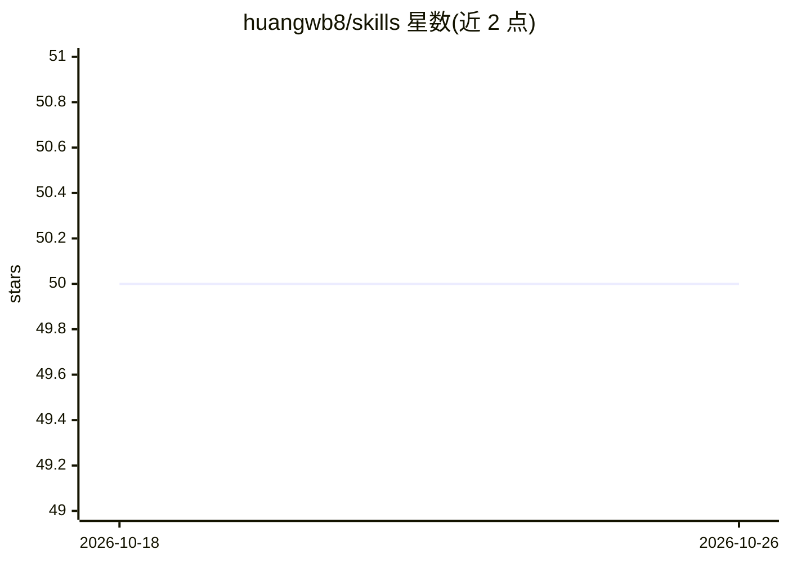

# huangwb8/skills

⭐ 50 · Python · MIT · 推送 2026-10-17 · [GitHub](https://github.com/huangwb8/skills) · 个人维护 · 中文 README

**Agent Skill 集合与开发流水线：创建、安装、检查、追踪 Skill 执行**

遵循 Agent Skills 开放标准的可复用 Skill 集合与工程化流水线：`skills/alpha` 提供 17 个生产 Skill（自动测试、多 Agent 协作、Prompt 优化、Git 操作、科研绘图等），安装器把 Skill 复制到 Codex/Claude Code 的技能目录；执行内核 bensz-skill-kernel（bsk CLI，v2.1.6）提供任务阶段管理、自动检查、证据记录、事件账本与执行记录重放。远程 bootstrap 兼容 Python 3.8+，本地安装与 Kernel 需 Python 3.11+，依赖仅 PyYAML 与标准库。

## 筛选速览

| 维度 | 判定 | 备注 |
|---|---|---|
| AI 角色 | `ai-ecosystem` | LLM/agent 周边工具 |
| 许可风险 | `permissive` | MIT |
| 部署形态 | `library` | 以包/库形式分发 |
| 模型依赖 | — | README 未给出锁定关系 |
| 硬件要求 | — | 无带数字的原话,不猜 |
| 安装摩擦 | `low` | 无编译、无系统依赖或容器化 |
| 成熟度 | — | 结构信号不足 |

## 能力要点

- 17 个可直接安装的生产 Skill，覆盖测试、协作、Prompt 优化、Git 流程
- bsk 内核提供任务阶段管理、检查、证据记录与执行重放
- 远程引导安装无需克隆仓库，默认装到 ~/.codex/skills 与 ~/.claude/skills
- 遵循 Agent Skills 开放标准，Skill 与通用执行工具分离

## 适用场景

- 给 Claude Code/Codex CLI 补充可复用的工作流技能
- 系统化管理与验证 Agent Skill 的触发、步骤与执行证据
- 团队对 Skill 开发做文档化、测试与迭代管理

## 场景标签

`Agent 框架` · 领域:Agent 开发

## 证据(README 行号)

> L5: 一套遵循 Agent Skills 开放标准 的可复用 Skill 集合、开发流水线，以及帮助检查和追踪 Skill 执行过程的工具。
> L22: - **可直接使用的通用 Skills**：覆盖自动测试、多 Agent 协作、并行工作区、Prompt 优化、科研绘图、Git 操作、安装、文档和缺陷反馈。
> L59: - **任务执行内核**：`packages/bensz-skill-kernel/` 提供 `bsk` CLI，用来管理任务阶段、执行检查、保存证据、记录事件，并重放执行记录。

## 星数曲线

2026-10-18 50 → 2026-10-26 50（+0）

---
*卡片 v1 · prompt 1.4 · 生成 2026-10-24 · 置信度 mid · 依据 README sha `83456d41e0fb` · [字段定义](../../DATASET.md)*
