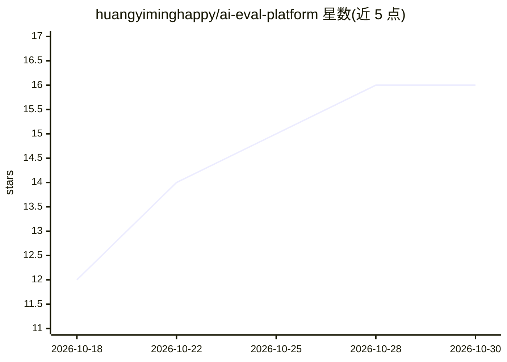

# huangyiminghappy/ai-eval-platform

⭐ 16 · Python · Apache-2.0 · 推送 2026-07-20 · [GitHub](https://github.com/huangyiminghappy/ai-eval-platform) · 个人维护 · 中文 README

**自托管 AI 应用评测平台：评测 RAG/Agent/多轮对话与接口**

自托管的 Web 评测工作台，将数据集管理、场景预设（RAG、Agent、多轮对话）、内置指标、OpenAI 兼容的 LLM-as-Judge、在线接口评测、报告分析与人工盲测整合在一个界面中。支持离线评测已有输出或直接调用 Chat/RAG/Agent 接口在线评测，默认 judge 模型为 DashScope 兼容模式下的 Qwen Plus，可替换为任意兼容模型。后端 FastAPI + SQLite（支持 PostgreSQL），前端 React 18，需 Python 3.9+ 与 Node.js 18+ 分别启动；项目面向可信内部用户，对外暴露前需自行添加认证。

## 筛选速览

| 维度 | 判定 | 备注 |
|---|---|---|
| AI 角色 | `ai-ecosystem` | LLM/agent 周边工具 |
| 许可风险 | `permissive` | Apache-2.0 |
| 部署形态 | `library` | 以包/库形式分发 |
| 模型依赖 | — | README 未给出锁定关系 |
| 硬件要求 | — | 无带数字的原话,不猜 |
| 安装摩擦 | `low` | 无编译、无系统依赖或容器化 |
| 成熟度 | — | 结构信号不足 |

## 能力要点

- RAG/Agent/多轮对话三类场景的内置指标（Faithfulness、Tool Correctness、Topic Adherence 等）
- 在线接口评测：调用目标端点提取响应/上下文/工具调用并直接评分
- 人工盲测：随机顺序对比两组输出并汇总人投偏好
- OpenAI 兼容 judge 模型，默认 Qwen Plus（DashScope 兼容模式）

## 适用场景

- 上线前对新的模型、RAG 服务、prompt 版本或 Agent 实现做 A/B 盲测
- 团队以工程化流程持续评测 LLM 应用并查看行级评分与判分理由
- 对客服机器人、企业助手做多轮对话稳定性评测

## 场景标签

`模型评测` · 领域:评测与运维

## 证据(README 行号)

> L13: AI Evaluation Platform helps teams evaluate LLM applications as an engineering workflow instead of a one-off metric
> L70: - Offline evaluation and live endpoint evaluation for Chat, RAG, and Agent services.
> L75: Compared with library-first tools such as Ragas, rag_eval, or dataset-focused tools, this platform emphasizes repea

## 星数曲线

2026-10-18 12 → 2026-10-30 16（+4）

---
*卡片 v1 · prompt 1.4 · 生成 2026-10-30 · 置信度 high · 依据 README sha `f3bc34eee163` · [字段定义](../../DATASET.md)*
