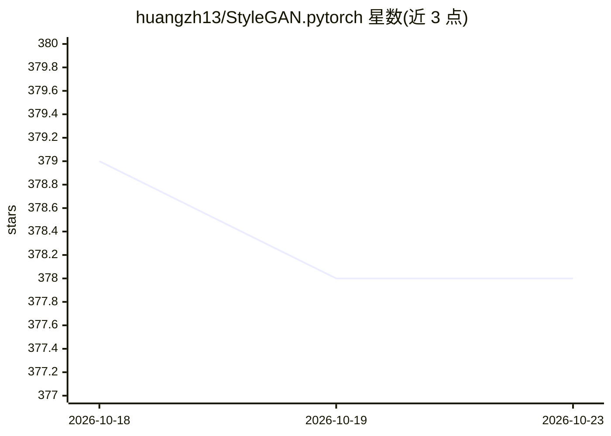

# huangzh13/StyleGAN.pytorch

⭐ 378 · Python · NOASSERTION · 推送 2026-09-02 · [GitHub](https://github.com/huangzh13/StyleGAN.pytorch) · 个人维护

**StyleGAN 的非官方 PyTorch 复现，面向历史复现与代码阅读**

在 NVIDIA 官方 PyTorch 实现发布前完成的 StyleGAN 历史性非官方 PyTorch 实现，实现渐进式增长、风格混合正则、截断技巧、条件 GAN 等特性，提供训练、样本生成、网格、W 空间插值与风格混合图像脚本，以及 TensorFlow 权重转换工具（兼容性未验证）。README 声明为保守维护的遗留研究软件，不承诺现代环境兼容、CPU-only 或多 GPU/FP16 支持，新项目建议改用官方 StyleGAN2-ADA。预训练权重与数据集不含在内。

## 筛选速览

| 维度 | 判定 | 备注 |
|---|---|---|
| AI 角色 | `ai-native` | 本体是模型或模型工具 |
| 许可风险 | `none` | NOASSERTION |
| 部署形态 | `library` | 以包/库形式分发 |
| 模型依赖 | — | README 未给出锁定关系 |
| 硬件要求 | — | 无带数字的原话,不猜 |
| 安装摩擦 | `medium` | 含编译或系统依赖之一 |
| 成熟度 | — | 结构信号不足 |

## 能力要点

- 实现 StyleGAN 原论文架构：渐进式增长、EMA、风格混合、截断技巧、条件 GAN
- 训练与生成脚本：样本、网格、W 空间确定性插值 GIF、风格混合图
- TensorFlow→PyTorch 权重转换脚本（遗留路径，兼容性未验证）
- README 明确声明遗留软件状态与多项未验证项

## 适用场景

- 阅读与研究 StyleGAN 原始架构的 PyTorch 实现
- 复现或扩展依赖此代码库的历史实验
- 从官方 TensorFlow 权重转换并验证生成结果

## 场景标签

`模型训练` `图像生成` · 领域:内容生成

## 证据(README 行号)

> L3: > A historical, unofficial PyTorch implementation of the original StyleGAN.
> L5: This repository implements the StyleGAN architecture described in [A Style-Based
> L6: Generator Architecture for Generative Adversarial Networks](http://stylegan.xyz/paper).

## 星数曲线

2026-10-18 379 → 2026-10-23 378（-1）

---
*卡片 v1 · prompt 1.4 · 生成 2026-10-21 · 置信度 high · 依据 README sha `c77b597257a1` · [字段定义](../../DATASET.md)*
