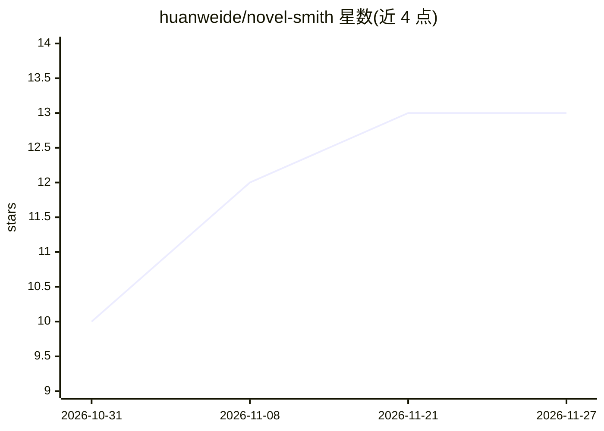

# huanweide/novel-smith

⭐ 13 · TypeScript · MIT · 推送 2026-11-16 · [GitHub](https://github.com/huanweide/novel-smith) · [官网](https://huanweide.github.io/novel-smith/) · 个人维护 · 中文 README

**网文作者的本地 AI 长篇写作工坊**

基于 Next.js/Electron 的本地优先长篇网文写作应用：AI 起草灵感、世界观、章纲与逐章正文，作者拍板修改。通过分层记忆引擎（近章全文+摘要+远层压缩、S/A/B/C 事件衰减）与全书设定 LLM 互审维持跨章一致性；每章自动抽取人物/势力生成角色卡与世界书（15 类分类）。数据存本地 SQLite 单文件，宣称稿件与 API Key 不出本机。桌面版提供 Windows NSIS 安装包与自动更新；也可 npm 本地运行或部署到 Vercel+Turso。

## 筛选速览

| 维度 | 判定 | 备注 |
|---|---|---|
| AI 角色 | `ai-native` | 本体是模型或模型工具 |
| 许可风险 | `permissive` | MIT |
| 部署形态 | `desktop` | 安装包/桌面程序 |
| 模型依赖 | locked-api |  |
| 硬件要求 | — | 无带数字的原话,不猜 |
| 安装摩擦 | `low` | 无编译、无系统依赖或容器化 |
| 成熟度 | — | 结构信号不足 |

## 能力要点

- 分层记忆引擎：近 4 章全文+近 3 章摘要+远楼层压缩，配 S/A/B/C 事件衰减
- 全书一致性互审：设定事实跨章 LLM 核对，矛盾带章号锚点与误报抑制
- 创意工坊预设市场：17 个内置文风/世界观/角色卡模板一键套用
- 五格式导出（TXT/Markdown/HTML/EPUB/DOCX），支持 API Key 可选配置

## 适用场景

- 从一句话灵感开始让 AI 起草整部长篇网文
- 长期维护上百章的人设、伏笔与世界观不漂移
- 稿件不想上传云端，全部本地保存
- 把写好的小说变成第一人称互动游戏模式体验

## 场景标签

`AI 写作` `知识库管理` · 领域:内容生成

## 证据(README 行号)

> L13: # 🔨 Novel Smith — AI 长篇网文写作工坊
> L135: |用 AI 写一部长篇网文|AI 起草：从灵感、世界观、章纲到逐章正文，全程 AI 帮你写，你只管拍板|
> L46: - 🔒 **未发表稿件零上传** —— 全部存在你电脑上的一个本地 SQLite 文件里，正文和 API Key 都不出本机；无账号、无云、无遥测。

## 星数曲线

2026-10-31 10 → 2026-11-27 13（+3）

---
*卡片 v1 · prompt 1.4 · 生成 2026-11-18 · 置信度 high · 依据 README sha `78d6b52843f0` · [字段定义](../../DATASET.md)*
