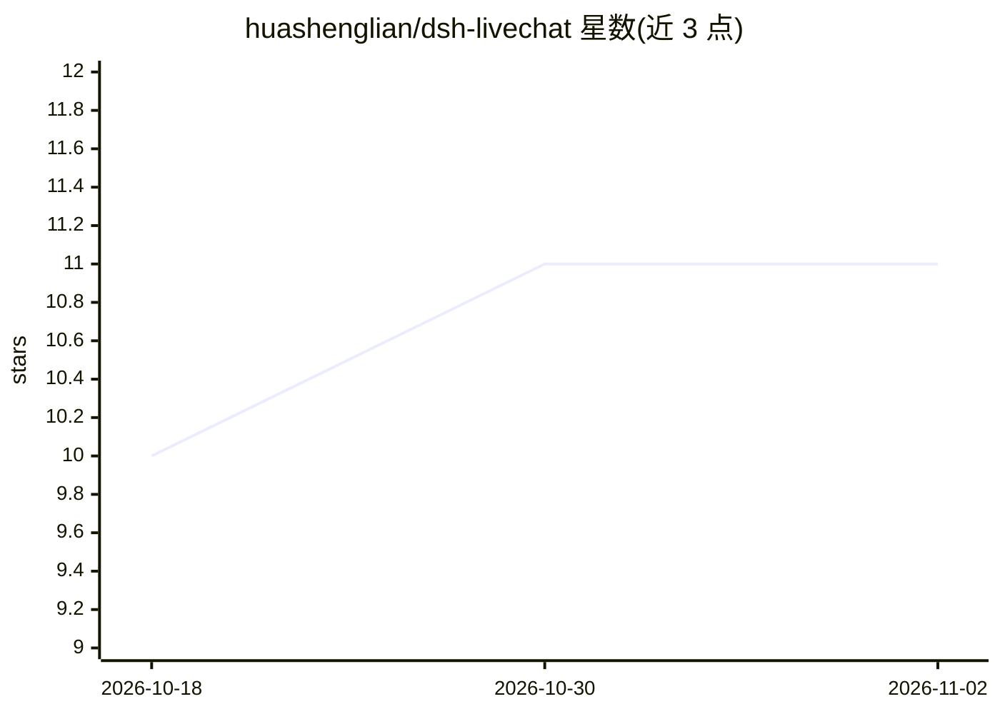

# huashenglian/dsh-livechat

⭐ 11 · JavaScript · MIT · 推送 2026-10-28 · [GitHub](https://github.com/huashenglian/dsh-livechat) · [官网](https://github.com/huashenglian/dsh-livechat) · 个人维护 · 中文 README

**给 dsh 对话区叠加 B 站风格弹幕的插件，可选 LLM 生成弹幕**

DeepSeek Harness（dsh）的 bundle 插件：在 Web/桌面端对话区上叠加 B 站风格弹幕，用户消息、回复完成、工具调用、任务完成等事件触发预设弹幕或可选 LLM 生成的吐槽。功能含多轨道防碰撞渲染、拖球快捷控制、三套预设包、LLM 专属的分会话弹幕池与回放、礼物特效模块，LLM 缓冲区内容经 redactSecrets 脱敏。通过 dsh plugin 命令安装，预设生成不依赖 LLM，LLM 失败时静默降级到预设。

## 筛选速览

| 维度 | 判定 | 备注 |
|---|---|---|
| AI 角色 | `ai-enhanced` | 去掉 AI 部分产品仍成立 |
| 许可风险 | `permissive` | MIT |
| 部署形态 | `library` | 以包/库形式分发 |
| 模型依赖 | — | README 未给出锁定关系 |
| 硬件要求 | — | 无带数字的原话,不猜 |
| 安装摩擦 | `low` | 无编译、无系统依赖或容器化 |
| 成熟度 | — | 结构信号不足 |

## 能力要点

- 事件触发的预设弹幕 + 可选 LLM 生成（smart/interval/toolcall 唤醒）
- 多轨道防碰撞渲染，DOM/WebGL2 后端链，Chromium 优先调优
- LLM 弹幕专属分会话池、历史回放与点赞加权，LLM 输入经脱敏处理
- v0.6.8 起支持 dsh 桌面端（Electron）

## 适用场景

- 围观 agent 工作时以直播弹幕形式呈现对话区事件
- 给 dsh 对话区加 B 站风格的互动与礼物特效
- 用 LLM 生成贴合上下文的即时吐槽弹幕

## 场景标签

 · 领域:开发者工具/桌面增强

## 证据(README 行号)

> L9: **给 DeepSeek Harness（`dsh`）Web 对话区叠加 B 站风格弹幕的插件。**
> L11: 围观 agent 工作：用户消息、回复完成、工具调用、任务完成时，预设弹幕（可选 LLM 生成）横向飘过对话区——就像看直播一样。
> L59: |**预设包与 LLM**|三套预设包、事件触发抽样、疲劳去重、预设功能总开关（关闭后仅剩 LLM）、可选 LLM 生成（smart/interval/toolcall 唤醒）、风格模板|presets-and-llm.zh-CN

## 星数曲线

2026-10-18 10 → 2026-11-02 11（+1）

---
*卡片 v1 · prompt 1.4 · 生成 2026-11-02 · 置信度 mid · 依据 README sha `7213fcb19c33` · [字段定义](../../DATASET.md)*
