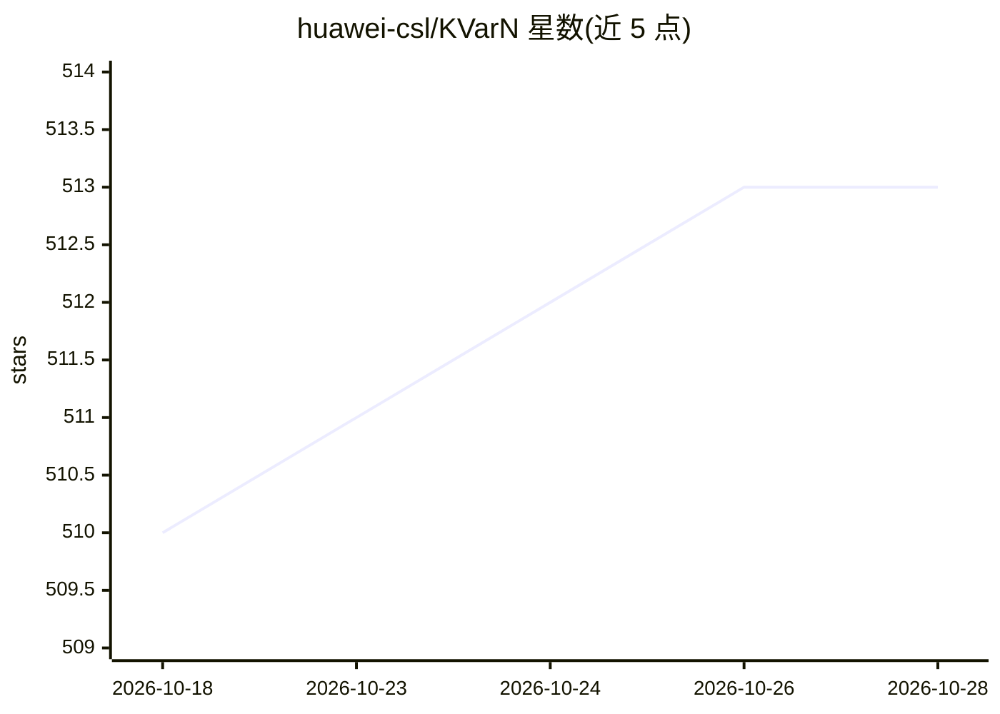

# huawei-csl/KVarN

⭐ 513 · Python · Apache-2.0 · 推送 2026-06-22 · [GitHub](https://github.com/huawei-csl/KVarN) · [官网](https://arxiv.org/abs/2606.03458) · 组织维护

**vLLM 原生 KV-cache 量化后端：免校准提升上下文容量**

以 vLLM fork 形式发布的 KV-cache 量化 attention 后端，通过 --kv-cache-dtype 一个参数启用，无需模型改动与校准。量化流程为 Hadamard 旋转、迭代方差归一化与不对称低比特舍入（预设 4-bit key / 2-bit value）。README 报告 3-5 倍 KV-cache 容量与不低于 FP16 的吞吐，支持 MLA 模型、Mamba/线性注意力混合模型与投机解码（MTP/DFlash），可与权重量化 checkpoint 组合。面向使用 vLLM 的推理服务开发者。

## 筛选速览

| 维度 | 判定 | 备注 |
|---|---|---|
| AI 角色 | `ai-ecosystem` | LLM/agent 周边工具 |
| 许可风险 | `permissive` | Apache-2.0 |
| 部署形态 | `library` | 以包/库形式分发 |
| 模型依赖 | local-ok | 支持本地模型 |
| 硬件要求 | — | 无带数字的原话,不猜 |
| 安装摩擦 | `medium` | 含编译或系统依赖之一 |
| 成熟度 | — | 结构信号不足 |

## 能力要点

- 免校准、单 flag 启用，KVarN 内核为 Triton、运行时 JIT 编译
- 支持 MLA 模型（压缩 KV latent 量化至 int4）与混合架构模型
- 兼容 MTP/DFlash 投机解码与权重量化（AWQ INT4）组合
- 量化流程：Hadamard 旋转 + 迭代方差归一化 + 低比特舍入

## 适用场景

- 长上下文/agent 负载下扩展 vLLM 服务的 KV-cache 容量
- 同显存下提高并发请求数
- 为 MLA 或混合注意力模型启用 sub-8-bit KV-cache 量化

## 场景标签

`模型量化` · 领域:训练与推理

## 证据(README 行号)

> L13: > 🔌 **Calibration-free, plug-and-play with vLLM.** A native vLLM attention backend: add one flag, no model changes,
> L41: KVarN ships as a vLLM fork. Install it like vLLM, then select the KVarN KV-cache dtype.

## 星数曲线

2026-10-18 510 → 2026-10-28 513（+3）

---
*卡片 v1 · prompt 1.4 · 生成 2026-10-22 · 置信度 high · 依据 README sha `3edd1c67c548` · [字段定义](../../DATASET.md)*
