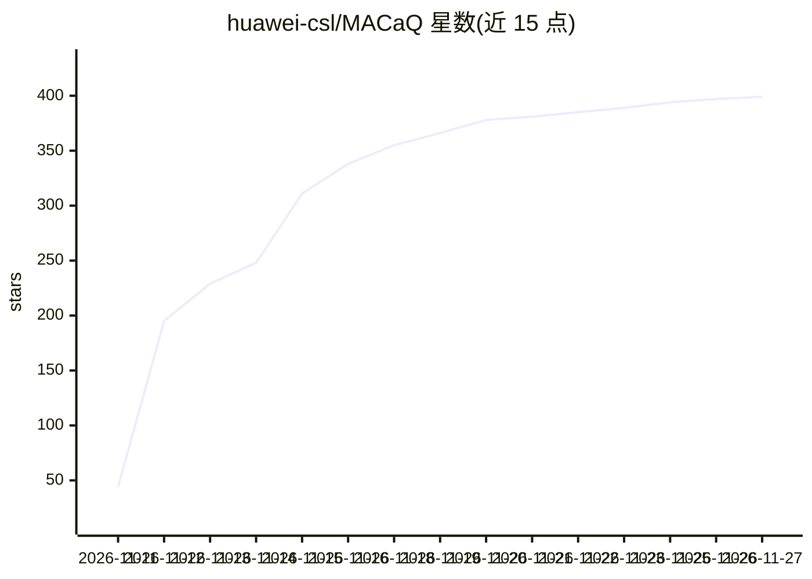

# huawei-csl/MACaQ

⭐ 399 · C++ · Apache-2.0 · 推送 2026-11-17 · [GitHub](https://github.com/huawei-csl/MACaQ) · [官网](https://huawei-csl.com/blog/macaq/) · 组织维护 · 中文 README

**面向本地推理的模型无关量化工具：文本/图像/视频/音频模型压至低比特**

MACaQ（Model Agnostic Calibrated Quantization）是一个量化工具与库，用于将文本、图像、视频、音频生成模型量化为 GGUF 或 W4A4 紧凑权重，并配套四种后端运行：llama.cpp（2/3/4-bit GGUF 文本生成）、vLLM（文本生成与 HTTP API 服务）、Diffusers（图像/视频/音频生成）、PyTorch（语音生成 WAV）。另提供 MACaQ-R，在保留原生格式的前提下精炼既有 GGUF 权重码，产物可在标准 llama.cpp 安装上直接运行。README 给出各后端的模型工作流链接与量化质量数据；Ascend 支持通过外部 CANN PR 提供内核。

## 筛选速览

| 维度 | 判定 | 备注 |
|---|---|---|
| AI 角色 | `ai-ecosystem` | LLM/agent 周边工具 |
| 许可风险 | `permissive` | Apache-2.0 |
| 部署形态 | `None` |  |
| 模型依赖 | local-ok | 支持本地模型 |
| 硬件要求 | — | 无带数字的原话,不猜 |
| 安装摩擦 | `low` | 无编译、无系统依赖或容器化 |
| 成熟度 | — | 结构信号不足 |

## 能力要点

- 四种后端覆盖文本/图像/视频/音频模型量化与生成
- MACaQ-R 精炼既有 GGUF 且兼容标准 llama.cpp 运行
- 支持 2/3/4-bit GGUF 与 W4A4、weight-only 等精度方案
- 各后端要求 Python 3.12 独立环境，llama.cpp 后端可 CPU 运行

## 适用场景

- 把大模型量化成 GGUF 后在本地用 llama.cpp 生成文本
- 为 vLLM 服务压缩模型权重并输出低精度 checkpoint
- 量化 Diffusers/PyTorch 的图像、视频、语音生成模型
- 精炼社区已有 GGUF 以适配自己的负载

## 场景标签

`模型量化` · 领域:训练与推理

## 证据(README 行号)

> L11: Quantize and run text, image, video and audio models with llama.cpp, vLLM,
> L28: ## Choose your backend
> L31: - **llama.cpp**: text generation, 2/3/4-bit GGUF.

## 星数曲线

2026-11-11 44 → 2026-11-27 399（+355）

---
*卡片 v1 · prompt 1.4 · 生成 2026-11-25 · 置信度 high · 依据 README sha `74775016eb38` · [字段定义](../../DATASET.md)*
