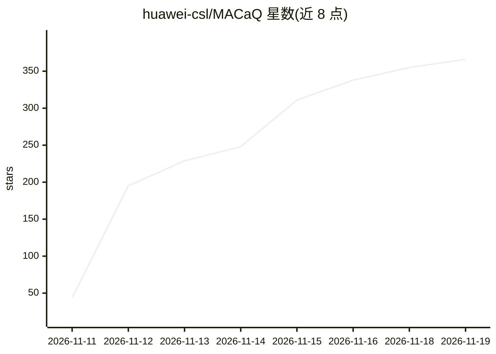

# huawei-csl/MACaQ

⭐ 366 · C++ · Apache-2.0 · 推送 2026-11-17 · [GitHub](https://github.com/huawei-csl/MACaQ) · [官网](https://huawei-csl.com/blog/macaq/) · 组织维护 · 中文 README

**模型无关的校准量化工具：压缩文本/图像/音频模型供本地推理**

MACaQ 提供跨模态（文本、图像、视频、音频、语音）模型的低比特量化：文本走 llama.cpp 生成 2/3/4-bit GGUF，扩散模型经 Diffusers 以 W4A4 量化生成图像/视频/音频，vLLM 支持 W4A4 或 weight-only 服务化，PyTorch 面向语音生成。另提供 MACaQ-R，可精炼已有 GGUF 并保持与标准 llama.cpp 兼容。README 给出 122B 模型 64 分钟、32.5GB 显存的量化数据，并发布 Ascend CANN 内核的 PR。需 Python 3.12，各后端建议独立环境。

## 筛选速览

| 维度 | 判定 | 备注 |
|---|---|---|
| AI 角色 | `ai-ecosystem` | LLM/agent 周边工具 |
| 许可风险 | `permissive` | Apache-2.0 |
| 部署形态 | `None` |  |
| 模型依赖 | local-ok | 支持本地模型 |
| 硬件要求 | — | 无带数字的原话,不猜 |
| 安装摩擦 | `low` | 无编译、无系统依赖或容器化 |
| 成熟度 | — | 结构信号不足 |

## 能力要点

- 模型无关校准量化，覆盖文本/图像/视频/音频后端（llama.cpp、vLLM、Diffusers、PyTorch）
- MACaQ-R 精炼已有 GGUF 且保持标准 llama.cpp 兼容
- README 数据：122B 模型 64 分钟量化、32.5GB 显存
- Ascend W4A4 密集与分组 matmul 内核以 CANN PR 形式提供

## 适用场景

- 把大模型量化成 GGUF 在本地 llama.cpp 上运行
- 压缩扩散模型以降低图像/视频/音频生成成本
- 用 vLLM 做 W4A4 量化推理与服务化
- 在昇腾平台上使用 W4A4 内核

## 场景标签

`模型量化` · 领域:训练与推理

## 证据(README 行号)

> L9: Quantize and run text, image, video and audio models with llama.cpp, vLLM,
> L28: - **Diffusers**: image, video and audio generation, W4A4.

## 星数曲线

2026-11-11 44 → 2026-11-19 366（+322）

---
*卡片 v1 · prompt 1.4 · 生成 2026-11-17 · 置信度 high · 依据 README sha `fc5c169b25ce` · [字段定义](../../DATASET.md)*
