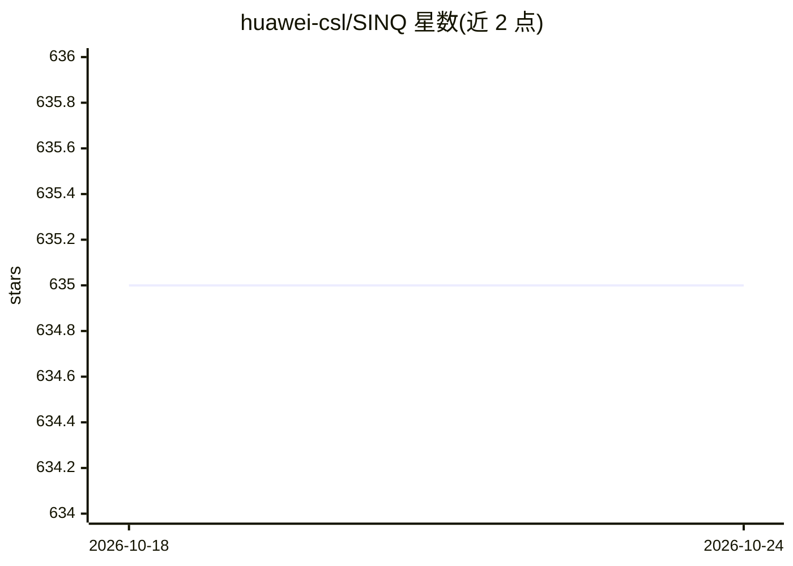

# huawei-csl/SINQ

⭐ 635 · Python · Apache-2.0 · 推送 2026-05-08 · [GitHub](https://github.com/huawei-csl/SINQ) · [官网](https://www.arxiv.org/abs/2509.22944) · 组织维护 · 中文 README

**面向 LLM 的免校准低比特量化方法库，压缩模型并保持精度**

华为开源的 LLM 量化方法（ICML 2026 论文，已并入 HF Transformers）：通过双缩放与 Sinkhorn 启发的行列归一化重分配离群权重影响，支持 2/3/4/5/6/8 比特、对称/非对称与 NF4 非均匀量化，可调 tiling 与 group size。提供 pip 包与源码克隆两种使用方式，量化后模型可存为分片 safetensors 或 .pt 并免基权重加载；另提供 Hugging Face 预量化模型集合与兼容 GGUF/AWQ/GPTQ/HQQ 的 pre-SINQ 重参数化算法。面向需要在有限显存上部署大模型的开发者与科研人员；限制：HF Transformers 集成仅支持 SINQ 不支持 A-SINQ。

## 筛选速览

| 维度 | 判定 | 备注 |
|---|---|---|
| AI 角色 | `ai-ecosystem` | LLM/agent 周边工具 |
| 许可风险 | `permissive` | Apache-2.0 |
| 部署形态 | `library` | 以包/库形式分发 |
| 模型依赖 | local-ok | 支持本地模型 |
| 硬件要求 | — | 无带数字的原话,不猜 |
| 安装摩擦 | `medium` | 含编译或系统依赖之一 |
| 成熟度 | — | 结构信号不足 |

## 能力要点

- 免校准、模型架构无关的即插即用量化，支持 2-8 比特与 NF4
- 已集成 Hugging Face Transformers（SinqConfig + AutoModelForCausalLM）
- 量化模型可存为分片 safetensors / .pt 并免基权重重载
- pre-SINQ 重参数化兼容 GGUF/AWQ/GPTQ/HQQ，输出与原模型数学等价

## 适用场景

- 把大参数模型量化到低比特以在单卡上部署
- 用 HF Transformers API 直接量化任意 CausalLM
- 复现论文的 INT4/NF4/A-SINQ 实验结果
- 生成 pre-SINQ 预处理的 GGUF 量化模型

## 场景标签

`模型量化` · 领域:训练与推理

## 证据(README 行号)

> L11: > ⚡️ **A fast, plug-and-play, model-agnostic quantization technique** delivering **state-of-the-art performance** f
> L36: **SINQ** (Sinkhorn-Normalized Quantization) is a **novel, fast and high-quality quantization method** designed to m
> L93: >There are two ways to use SINQ: directly through the Hugging Face Transformers integration, or by cloning this rep

## 星数曲线

2026-10-18 635 → 2026-10-24 635（+0）

---
*卡片 v1 · prompt 1.4 · 生成 2026-10-21 · 置信度 high · 依据 README sha `602da9b11610` · [字段定义](../../DATASET.md)*
