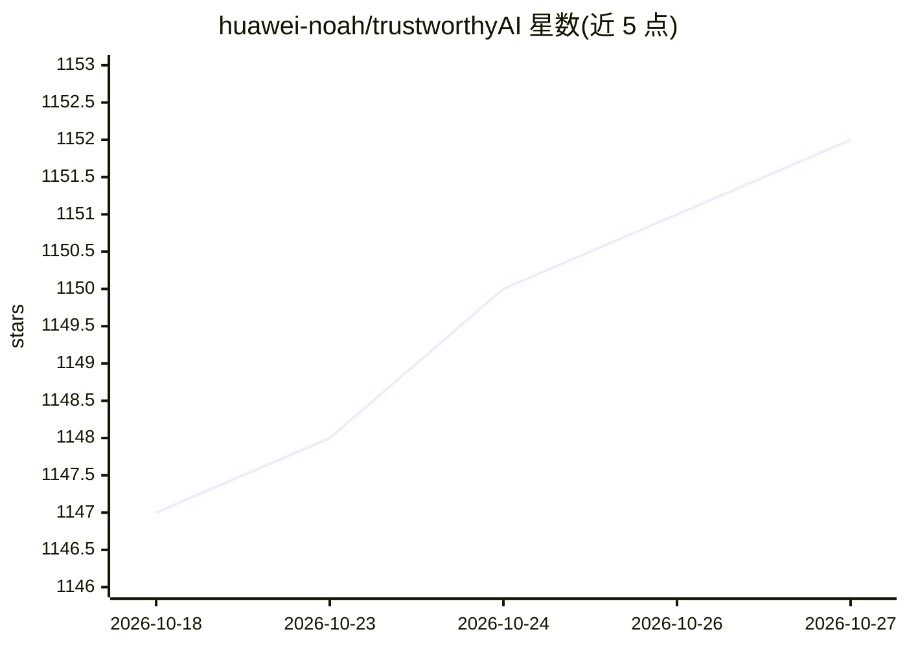

# huawei-noah/trustworthyAI

⭐ 1,152 · Python · Apache-2.0 · 推送 2026-09-21 · [GitHub](https://github.com/huawei-noah/trustworthyAI) · 组织维护 · 中文 README

**华为诺亚方舟实验室可信 AI 相关项目集合仓库**

聚合华为诺亚方舟实验室在可信 AI 方向的多类产出：gCastle 因果结构学习工具链（以梯度方法为主的因果发现算法）；因果相关竞赛信息与基线（PCIC 2021/2022、NeurIPS 2023）；真实数据集与合成数据生成代码；因果研究方法实现（CausalVAE、GAE、强化学习因果发现）；以及时间序列基础模型 Tabby 的预训练代码，支持预测、分类与异常检测，权重发布于 Hugging Face（paris-noah/Tabby）。各子目录为独立项目，README 未给出统一的安装入口。

## 筛选速览

| 维度 | 判定 | 备注 |
|---|---|---|
| AI 角色 | `ai-native` | 本体是模型或模型工具 |
| 许可风险 | `permissive` | Apache-2.0 |
| 部署形态 | `None` |  |
| 模型依赖 | — | README 未给出锁定关系 |
| 硬件要求 | — | 无带数字的原话,不猜 |
| 安装摩擦 | `low` | 无编译、无系统依赖或容器化 |
| 成熟度 | — | 结构信号不足 |

## 能力要点

- gCastle：基于梯度的因果结构学习工具链与评测功能
- CausalVAE、GAE、强化学习因果发现等研究实现
- Tabby 时间序列基础模型预训练代码开源，含 GIFT-Eval/UCR/TSB-AD 评测
- 提供真实数据集与合成数据（含结构因果模型采样）生成代码

## 适用场景

- 做因果发现或因果推断研究时获取算法实现与基线
- 训练或评测时间序列基础模型 Tabby
- 获取因果相关竞赛信息与数据集

## 场景标签

`模型训练` `强化学习` · 领域:训练与推理

## 证据(README 行号)

> L3: This repository is a collection of trustworthy AI related works from Huawei Noah's Ark Lab.
> L8: - The package offers a number of causal discovery algorithms, most of which are gradient-based, hence the name: **g*
> L27: - **Tabby**, a time series foundation model proposed by the Paris team of Huawei Noah's Ark Lab, supporting forecas

## 星数曲线

2026-10-18 1,147 → 2026-10-27 1,152（+5）

---
*卡片 v1 · prompt 1.4 · 生成 2026-10-21 · 置信度 high · 依据 README sha `79c8cd3374d3` · [字段定义](../../DATASET.md)*
