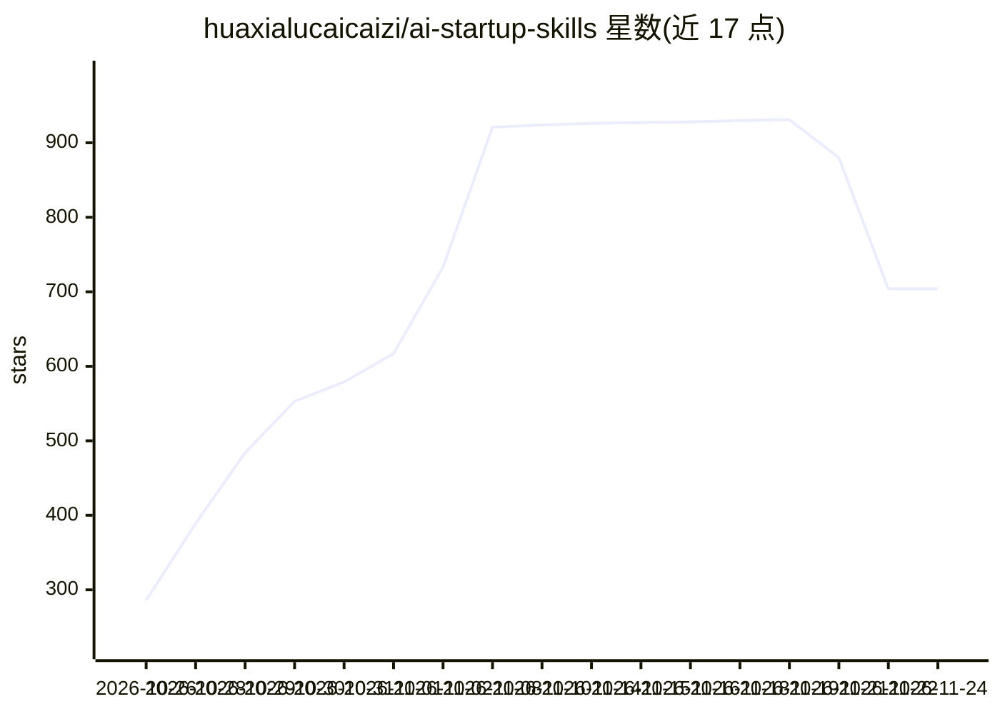

# huaxialucaicaizi/ai-startup-skills

⭐ 704 · Python · NOASSERTION · 推送 2026-11-18 · [GitHub](https://github.com/huaxialucaicaizi/ai-startup-skills) · 个人维护 · 中文 README

**一人公司做 AI 产品的 7 步 Agent Skill 合集**

把 7 个独立 Agent Skill 打包为合集并附带一个总入口路由 skill：用户说明在做的产品和进度后，入口判断创业阶段并调用对应子 skill，各步产出（验证证据、BP、定价）可传递给下一步。子 skill 覆盖 MVP 验证、商业计划书、一人公司政策导航、路演教练、增长获客、定价成交、注册合规。通过 git clone 复制到 Codex/Claude Code 等技能目录安装，提供 sync.sh 同步与 validate.py 校验脚本。README 声明仅提供信息参考、非法律税务意见，政策与合规部分主要面向中国大陆。

## 筛选速览

| 维度 | 判定 | 备注 |
|---|---|---|
| AI 角色 | `ai-knowledge` | 知识聚合/清单类 |
| 许可风险 | `none` | NOASSERTION |
| 部署形态 | `None` |  |
| 模型依赖 | — | README 未给出锁定关系 |
| 硬件要求 | — | 无带数字的原话,不猜 |
| 安装摩擦 | `low` | 无编译、无系统依赖或容器化 |
| 成熟度 | — | 结构信号不足 |

## 能力要点

- 总入口 skill 按创业阶段路由到对应子 skill，最多追问两个问题
- 7 个子 skill 产出串联：验证证据 → BP → 政策申请/路演
- 支持 Codex、Claude Code 及其他支持 Agent Skills 的工具安装
- 声明不编造数据、政策法规只附官方原文链接

## 适用场景

- 一人公司创业前先验证 AI 产品需求再动手开发
- 写商业计划书和园区、孵化器、创业大赛的路演材料
- 查找可申请的政策补贴并规划一人公司注册与合规流程
- 在小红书、抖音、视频号做冷启动获客与定价成交

## 场景标签

`提示工程` · 领域:Agent 开发

## 证据(README 行号)

> L23: 「一人公司工具包」的合集仓库：把 7 个独立的 Agent Skill 打包在一起，再加一个**总入口 skill**。你只要说清楚在做什么、做到哪一步，它会判断你处在创业的哪个阶段，然后调用对应的子 skill。
> L36: |1|**AI MVP Validation · AI 产品 MVP 验证**|先验证有没有人要，再写代码、写 BP|
> L68: 克隆本仓库，把 `skills/` 下的 7 个子 skill 和总入口一起放进你的技能目录。

## 星数曲线

2026-10-26 286 → 2026-11-24 704（+418）

---
*卡片 v1 · prompt 1.4 · 生成 2026-11-24 · 置信度 high · 依据 README sha `aaffef72a5a8` · [字段定义](../../DATASET.md)*
