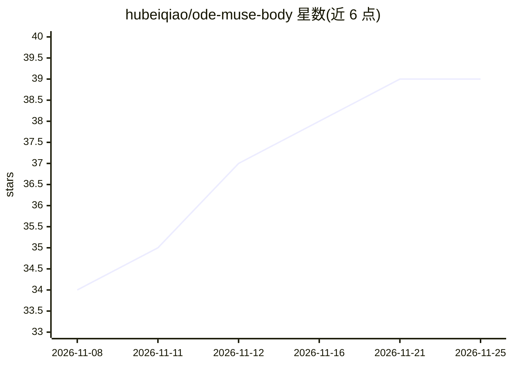

# hubeiqiao/ode-muse-body

⭐ 39 · Python · MIT · 推送 2026-11-04 · [GitHub](https://github.com/hubeiqiao/ode-muse-body) · [官网](https://youtu.be/0wcoqi5CVuQ) · 个人维护

**让 AI agent 经 ESP32 蓝牙实体操控闲置 iPad 的具身系统**

独立开源的具身 AI 项目（Meta 黑客松作品）：将 Muse Spark 模型接入一台闲置 iPad mini，使其能看（AirPlay 镜像屏幕、摄像头经 Gemini Live）、说（实时语音对话）、行动（约 5 美元的 ESP32-C3 以蓝牙键鼠身份点击、输入、滑动真实应用），无需越狱或开发者模式。Mac 作为协调器运行接收器与本地 OCR，屏幕画面交由 muse-spark-1.3 规划下一步；含 24 张注册技能卡、有界研究目标、可编辑记忆库与持久任务回执。需要自备 Mac、iPad 与 Meta/Gemini API key。

## 筛选速览

| 维度 | 判定 | 备注 |
|---|---|---|
| AI 角色 | `ai-native` | 本体是模型或模型工具 |
| 许可风险 | `permissive` | MIT |
| 部署形态 | `None` |  |
| 模型依赖 | — | README 未给出锁定关系 |
| 硬件要求 | — | 无带数字的原话,不猜 |
| 安装摩擦 | `low` | 无编译、无系统依赖或容器化 |
| 成熟度 | `idea` | |

## 能力要点

- 像素→决策→蓝牙输入→屏幕反馈的闭环，操控未修改的 iPad
- ESP32-C3（约 $5）作为蓝牙 HID 执行点击/输入/滑动
- 无需越狱、开发者模式、Xcode 或应用 API
- 24 张注册技能卡、有界研究目标、可编辑记忆库与持久任务回执

## 适用场景

- 把闲置 iPad 变成 AI agent 的实体操作终端
- 让 AI 通过真实应用完成看、说、点击的任务
- 在有人值守下让 AI 用原生 app 做只读或受控任务

## 场景标签

`GUI 自动化` `语音 Agent` · 领域:效率与自动化

## 证据(README 行号)

> L67: 2. **Think.** **Muse Spark** (`muse-spark-1.3`, Meta Model API) reads the screen and plans the next step. Known app
> L68: 3. **Act.** The Mac sends the step over Wi-Fi to the ESP32, which taps, types and swipes as a Bluetooth keyboard an
> L39: - **It acts.** A $5 ESP32 is its hands: a Bluetooth keyboard and mouse, the same input a person uses. If you can ta

## 星数曲线

2026-11-08 34 → 2026-11-25 39（+5）

---
*卡片 v1 · prompt 1.4 · 生成 2026-11-18 · 置信度 high · 依据 README sha `016dc09419d4` · [字段定义](../../DATASET.md)*
