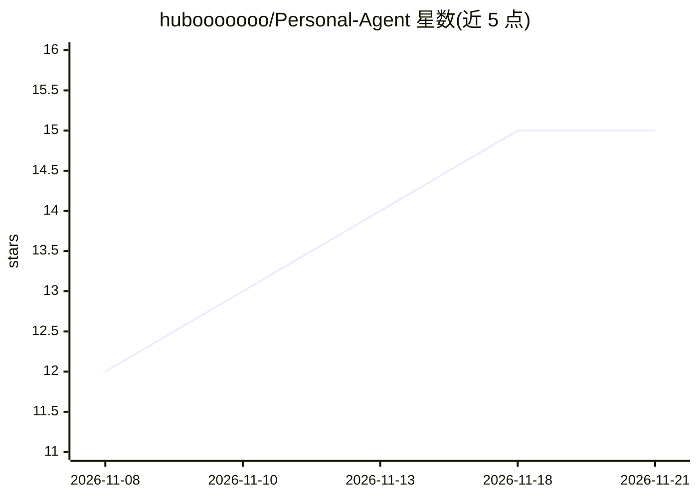

# hubooooooo/Personal-Agent

⭐ 15 · Python · MIT · 推送 2026-11-02 · [GitHub](https://github.com/hubooooooo/Personal-Agent) · 个人维护 · 中文 README

**带长期记忆与确认卡的个人 AI 助理底座，可二开**

基于 LangGraph + FastAPI + 原生 JS 前端的个人助理应用：沉淀姓名、偏好等事实为可查看、可修改、可遗忘的记忆卡；替用户起草邮件/文章并附一次性确认凭证；支持一次性提醒与只读定时任务。多渠道（网页/飞书/微信）绑定到同一档案，内置出站防泄露、隐私脱敏、危机识别与预算限制等护栏。模型默认 Kimi，可通过 .env 换 DeepSeek、通义、OpenAI 等任意 OpenAI 兼容接口。SQLite 默认存储，Docker 与 Render 一键部署。

## 筛选速览

| 维度 | 判定 | 备注 |
|---|---|---|
| AI 角色 | `ai-native` | 本体是模型或模型工具 |
| 许可风险 | `permissive` | MIT |
| 部署形态 | `self-host` | docker 或自建部署 |
| 模型依赖 | — | README 未给出锁定关系 |
| 硬件要求 | — | 无带数字的原话,不猜 |
| 安装摩擦 | `low` | 无编译、无系统依赖或容器化 |
| 成熟度 | `idea` | |

## 能力要点

- 事实型记忆卡：可查看、修改、遗忘，向量检索可选
- 所有有后果动作先出确认卡，外部工具需一次性参数绑定凭证
- 内置隐私门、出站防泄露、预算限制与金标回归测试
- 飞书/微信通过一次性链接绑定同一档案与记忆

## 适用场景

- 日常对话中让助理记住个人信息并起草邮件、文章草稿
- 通过飞书或微信与同一助理账号对话，共用记忆
- 设置一次性提醒与自定义只读定时任务
- 在应用底座上二次开发自己的 agent 工具与渠道

## 场景标签

`AI 助手` · 领域:对话与助手

## 证据(README 行号)

> L5: 陪你聊、记住你说过的事、替你起草、按时提醒。
> L100: |编排|LangGraph，`app/graph.py` → `app/agent/router.py` → `app/agent/subgraphs/`|三个子图：chat / draft+confirm / profile。

## 星数曲线

2026-11-08 12 → 2026-11-21 15（+3）

---
*卡片 v1 · prompt 1.4 · 生成 2026-11-18 · 置信度 high · 依据 README sha `6dcecc2e9f8e` · [字段定义](../../DATASET.md)*
