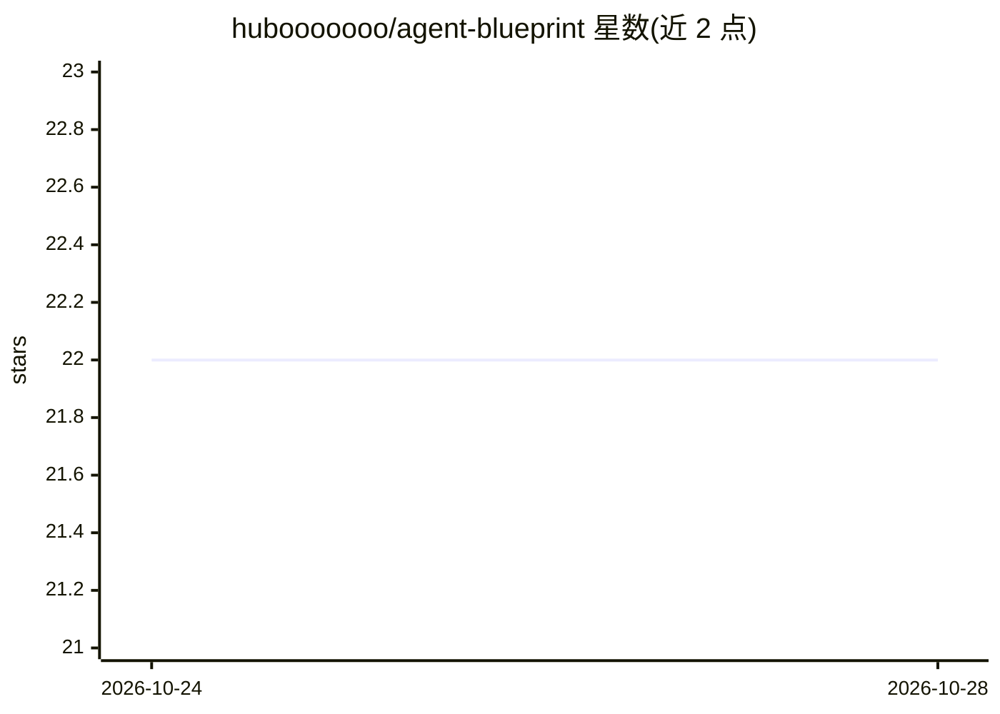

# hubooooooo/agent-blueprint

⭐ 23 · Python · MIT · 推送 2026-10-27 · [GitHub](https://github.com/hubooooooo/agent-blueprint) · 个人维护 · 中文 README

**本地运行的 Agent 产品推导引擎：从点子推导 PRD、架构方案与代码骨架**

面向想构建 Agent 产品的开发者与产品人员：输入一句话点子或半份 PRD，引擎调用模型做需求拆解与三轮追问，按固定规则从 17 个 Harness 组件中选型并给出理由，产出方案、七层架构、工具清单、提示词草案与独立审稿意见；代码骨架由用户自己的 AI 编程工具写入 skeleton/，引擎对照 PRD 生成差距报告，新需求经产品循环升版。提供 Mac 双击、AI 代跑、命令行三种方式；需模型 API Key，一次方案约 6 次调用 4 万 tokens；未部署上线功能。

## 筛选速览

| 维度 | 判定 | 备注 |
|---|---|---|
| AI 角色 | `ai-native` | 本体是模型或模型工具 |
| 许可风险 | `permissive` | MIT |
| 部署形态 | `None` |  |
| 模型依赖 | locked-api |  |
| 硬件要求 | — | 无带数字的原话,不猜 |
| 安装摩擦 | `low` | 无编译、无系统依赖或容器化 |
| 成熟度 | — | 结构信号不足 |

## 能力要点

- 按固定规则从 17 个 Harness 组件选型，同样判断得到同样选型
- 产品循环：新需求先落回 PRD 升版再重推方案，记录每轮选型变化
- 反向检查已有项目并生成差距报告与本该有的 PRD
- 三种使用方式：Mac 双击界面、交给本地 AI、命令行，支持 --resume 续跑

## 适用场景

- 把一句话点子推导成带组件选型理由的 PRD 与架构方案
- 让 AI 编程工具按方案写骨架后再对照 PRD 验收差距
- 检查已写的 Agent 项目缺哪些机制并排优先级

## 场景标签

`AI 写作` · 领域:内容生成

## 证据(README 行号)

> L5: **一句话点子 → 可确认的 PRD 与架构方案 → 你的 AI 写出能跑的骨架 → 引擎对照 PRD 验收 → 按新需求持续迭代**
> L7: 一个本地运行的 Agent 产品推导引擎。它不替你写代码，而是先把「该做什么、该用哪些机制、哪里还没想清楚」推导清楚，交给你自己的 AI 编程工具去写骨架，再对照 PRD 验收，陪你一轮轮把骨架做对。
> L18:  💡 一个点子或半份 PRD 「帮我出个方案」 <code>方案.md</code>：待确认问题、需求拆解、组件选型及理由、七层架构图、工具清单、系统提示词草案、独立审稿意见

## 星数曲线

2026-10-24 22 → 2026-10-28 22（+0）

---
*卡片 v1 · prompt 1.4 · 生成 2026-10-27 · 置信度 high · 依据 README sha `b761f4b5bfd3` · [字段定义](../../DATASET.md)*
