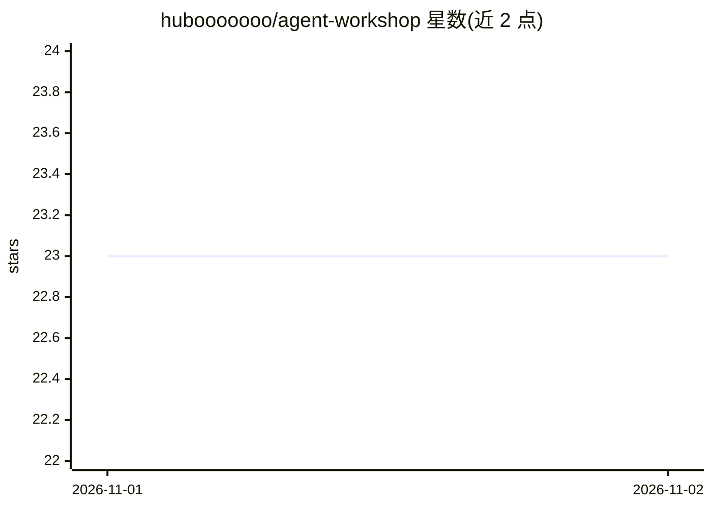

# hubooooooo/agent-workshop

⭐ 23 · Python · MIT · 推送 2026-11-01 · [GitHub](https://github.com/hubooooooo/agent-workshop) · 个人维护 · 中文 README

**本地运行的 Agent 产品推导引擎：从点子推导 PRD、架构方案与骨架验收**

本地运行的产品推导引擎：输入一句话点子或 PRD，由引擎拆解需求、按固定规则从 17 个 Harness 组件中选型、生成带架构图与审稿意见的方案；代码骨架交由用户自己的 AI 编程工具（如 Claude Code）写入 skeleton/，引擎再对照 PRD 验收差距、支持按新需求循环升版。有网页版（双击启动）与命令行/教学版。需模型 API Key（推荐 DeepSeek），组件选型由 rules.py 规则计算而非模型决定，agent 需模型支持工具调用，不支持时退回固定流程；仅 macOS/Linux 经过测试。

## 筛选速览

| 维度 | 判定 | 备注 |
|---|---|---|
| AI 角色 | `ai-ecosystem` | LLM/agent 周边工具 |
| 许可风险 | `permissive` | MIT |
| 部署形态 | `None` |  |
| 模型依赖 | locked-api |  |
| 硬件要求 | — | 无带数字的原话,不猜 |
| 安装摩擦 | `low` | 无编译、无系统依赖或容器化 |
| 成熟度 | — | 结构信号不足 |

## 能力要点

- 17 个 Harness 组件库（s01–s17），选型由固定规则计算，同样判断得到同样选型
- 引擎推导方案、AI 助手写骨架、引擎对照 PRD 验收的产品循环
- 反向检查：agent 只读方式翻代码核实组件，每条结论附真实文件行号
- 费用上限（默认每次运行最多 40 次调用/150 万 tokens），超出停下提示续跑

## 适用场景

- 把一句话点子推导成待确认问题清单、组件选型与架构方案
- 已有 Agent 项目做差距检查，得到缺哪些机制与证据行号
- 产品持续迭代：新需求先落回 PRD 升版再改骨架，保持文档与代码一致
- 导出交接包（需求、方案、参考代码、给 AI 编程工具的提示词）交给开发者

## 场景标签

 · 领域:Agent 开发工具

## 证据(README 行号)

> L7: 一个本地运行的 Agent 产品推导引擎。它不替你写代码，而是先把「该做什么、该用哪些机制、哪里还没想清楚」推导清楚，交给你自己的 AI 编程工具去写骨架，再对照 PRD 验收，陪你一轮轮把骨架做对。
> L44: - **AI 助手**负责写代码：按方案生成骨架，按迭代记录增量修改，只能写进 `out/<产品名>/skeleton/`。

## 星数曲线

2026-11-01 23 → 2026-11-02 23（+0）

---
*卡片 v1 · prompt 1.4 · 生成 2026-10-31 · 置信度 high · 依据 README sha `ba1f8acdc58d` · [字段定义](../../DATASET.md)*
