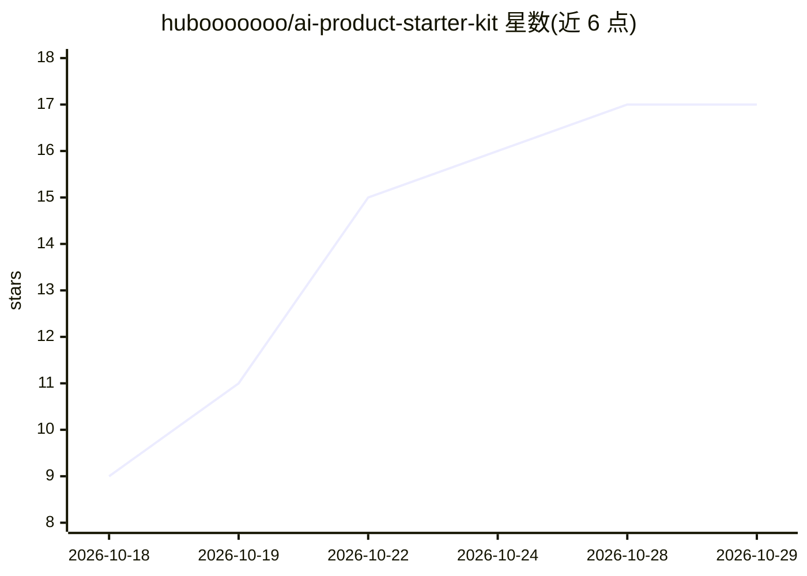

# hubooooooo/ai-product-starter-kit

⭐ 17 · Shell · MIT · 推送 2026-10-25 · [GitHub](https://github.com/hubooooooo/ai-product-starter-kit) · 个人维护 · 中文 README

**不懂代码的人用编码 AI 把 AI 产品从想法做到上线的工具包**

一个装着规则与手册的项目文件夹：包含 AI 规则卡（AGENTS.md）、三份技术手册、自检脚本 verify.sh 和产品经理操作手册。用户用编码 AI 工具（Claude Code/Codex/Pi）打开文件夹并贴启动句，AI 按规则卡分六个阶段执行：PRD 体检、技术适配、后端 MVP、前端、部署到腾讯云开发、收尾。用户只做业务判断和少数本人事项。每阶段 AI 须交证据包，其中五项由 verify.sh 脚本判定；规则卡写死密钥、数据持久化、真实模型验证等底线。仅支持 Mac，Windows 暂不支持；面向小范围试用的网页形态 MVP。

## 筛选速览

| 维度 | 判定 | 备注 |
|---|---|---|
| AI 角色 | `ai-ecosystem` | LLM/agent 周边工具 |
| 许可风险 | `permissive` | MIT |
| 部署形态 | `None` |  |
| 模型依赖 | — | README 未给出锁定关系 |
| 硬件要求 | — | 无带数字的原话,不猜 |
| 安装摩擦 | `low` | 无编译、无系统依赖或容器化 |
| 成熟度 | `idea` | |

## 能力要点

- AI 规则卡驱动六阶段流程，规则与进度存在文件夹而非模型记忆中
- 每阶段证据包 + verify.sh 自检脚本判定五项硬指标
- 规则卡内置密钥、持久化、真实模型验证、花钱先报价等强制底线
- 默认部署到腾讯云开发免费体验版，无需备案与自有域名

## 适用场景

- 产品经理或学生不会写代码也想做出并上线一个 AI 产品网页
- 让 AI 扮演技术合伙人，我只负责业务判断和验收
- 小范围用户试用一个生成、对话或分析类的 AI 产品 MVP

## 场景标签

`教程课程` · 领域:学习与行业

## 证据(README 行号)

> L19: 一个装着"规则"的空项目文件夹：一张 AI 规则卡、三份技术手册、一个自检脚本。
> L21: 你用编码 AI 工具打开它，贴一句启动句。AI 就按规则卡扮演你的技术合伙人：先帮你把需求问清楚，再按阶段写代码、做界面、部署上线，每个阶段交证据给你核对。你只做业务判断和少数必须本人做的事（申请 Key、实名认证、确认花钱）。

## 星数曲线

2026-10-18 9 → 2026-10-29 17（+8）

---
*卡片 v1 · prompt 1.4 · 生成 2026-10-29 · 置信度 high · 依据 README sha `1911ab5f9dbe` · [字段定义](../../DATASET.md)*
