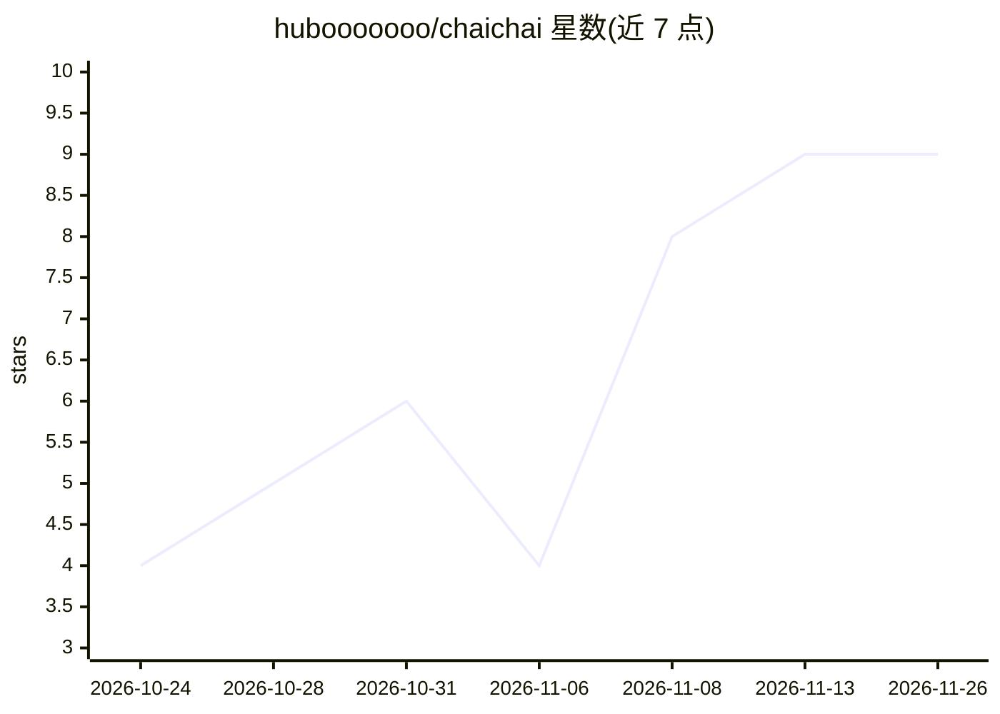

# hubooooooo/chaichai

⭐ 9 · TypeScript · MIT · 推送 2026-10-13 · [GitHub](https://github.com/hubooooooo/chaichai) · 个人维护 · 中文 README

**把 AI 助手接入 189 个软件拆解工具，帮你用中文看懂软件运作**

一套交给 AI 使用的软件分析工具箱：作为本地命令行工具与 MCP 服务器运行，接入 Codex、Claude Code、Cursor 等 20 多种 AI 助手后，AI 可自动调用工具拆解 Mac 应用、Electron 软件、网页代码、.apk、.NET/Go/Flutter 程序等，输出结构解读与带证据位置的中文说明。189 个工具大多只读，少数会运行程序或操作手机并需用户确认。提供一键安装脚本，自带 Node.js 运行环境，限 Apple 芯片 Mac。

## 筛选速览

| 维度 | 判定 | 备注 |
|---|---|---|
| AI 角色 | `ai-ecosystem` | LLM/agent 周边工具 |
| 许可风险 | `permissive` | MIT |
| 部署形态 | `desktop` | 安装包/桌面程序 |
| 模型依赖 | — | README 未给出锁定关系 |
| 硬件要求 | — | 无带数字的原话,不猜 |
| 安装摩擦 | `low` | 无编译、无系统依赖或容器化 |
| 成熟度 | — | 结构信号不足 |

## 能力要点

- 189 个软件拆解分析工具，支持网页、Electron、Mac 应用、apk、.NET/Go/Flutter 等
- 以 MCP 服务器形式接入 Codex、Claude Code、Cursor 等 20 多种 AI 工具
- 结论附证据位置，区分确定事实、推测与未知
- 自带 Node.js 运行环境，安装不依赖系统已有配置

## 适用场景

- 分析一个 Mac 应用由哪些组件和什么技术构成
- 弄清桌面软件界面与后台的消息传递机制
- 找出网页小游戏的计分规则
- 列出安卓 App 申请的权限和页面结构

## 场景标签

 · 领域:软件分析/逆向工程工具

## 证据(README 行号)

> L18: 拆拆是一套交给 AI 用的**拆解工具箱**。把它接入 Codex、Claude Code、Cursor 这类 AI 助手以后，AI 就能自己打开这台机器，一层层查看里面的代码和行为，再用大白话告诉你它是怎么运作的。
> L110: **支持的 AI 工具：** Codex、Claude Code、Cursor、Trae、VS Code、Qwen Code、Gemini CLI、Windsurf、OpenCode 等 20 多种。安装时会自动找到并接入你电脑
> L167: 拆拆是一个本地运行的命令行工具和 MCP 服务器，用 TypeScript 编写，需要 Node.js 22.19+ / 24.11+ / 26+。

## 星数曲线

2026-10-24 4 → 2026-11-26 9（+5）

---
*卡片 v1 · prompt 1.4 · 生成 2026-11-20 · 置信度 high · 依据 README sha `17fabf5c090a` · [字段定义](../../DATASET.md)*
