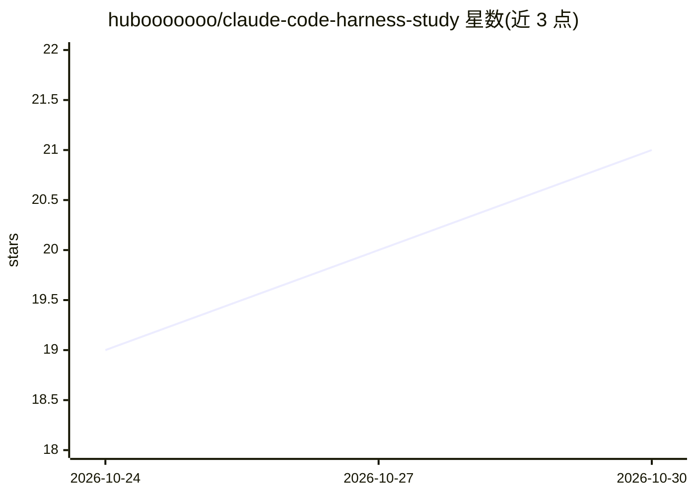

# hubooooooo/claude-code-harness-study

⭐ 21 · Python · MIT · 推送 2026-10-29 · [GitHub](https://github.com/hubooooooo/claude-code-harness-study) · 个人维护 · 中文 README

**面向学习者的 Agent Harness 工程教程：17 课拆解 Claude Code 机制**

以 "Agent 产品 = 模型 + Harness" 为核心观点的教学仓库：通过 17 个递进式课程（s01-s17），从最简 agent loop 开始，逐课加入工具注册、权限控制、Hooks、按需技能加载、上下文压缩、记忆、任务系统、后台任务、定时调度、多 agent 协作、MCP 插件、workflow 编排与目标闭环等 harness 机制，拆解并重组 Claude Code 的架构。面向零基础学生，Mac 提供双击启动脚本自动装依赖，需自备 DeepSeek API Key；也可在课程网页看讲解、代码对比与运行回放（回放无需 key）。设计模式声称可泛化到农业、酒店、制造等非编程领域。

## 筛选速览

| 维度 | 判定 | 备注 |
|---|---|---|
| AI 角色 | `ai-knowledge` | 知识聚合/清单类 |
| 许可风险 | `permissive` | MIT |
| 部署形态 | `None` |  |
| 模型依赖 | locked-api |  |
| 硬件要求 | — | 无带数字的原话,不猜 |
| 安装摩擦 | `low` | 无编译、无系统依赖或容器化 |
| 成熟度 | — | 结构信号不足 |

## 能力要点

- 17 个递进式课程，每课单独展开一个 harness 机制
- Mac 双击启动脚本自动检查/安装 Python 与依赖，引导配置 DeepSeek API Key
- 课程网页含讲解、代码高亮对比、运行回放（无需 key）与本机运行四个标签
- 每章附中文 README 完整叙事文档

## 适用场景

- 系统学习 coding agent 的 harness 机制与设计模式
- 想动手从零实现一个 agent loop 及配套工具链
- 在浏览器里回看每课真实运行的 messages[] 交互过程

## 场景标签

`教程课程` · 领域:学习与行业

## 证据(README 行号)

> L101: **17 个递进式课程, 从简单循环到目标闭环。**
> L151: 这是一个从 0 到 1 的 harness 工程课程。每章先单独展开一个机制，s15 再把累积的运行时接回完整的 Agent 循环。s16 在这个循环上加入 workflow 编排；s17 用更小的工具池单独讲目标控制的续跑，不

## 星数曲线

2026-10-24 19 → 2026-10-30 21（+2）

---
*卡片 v1 · prompt 1.4 · 生成 2026-10-28 · 置信度 high · 依据 README sha `9b445a5164ab` · [字段定义](../../DATASET.md)*
