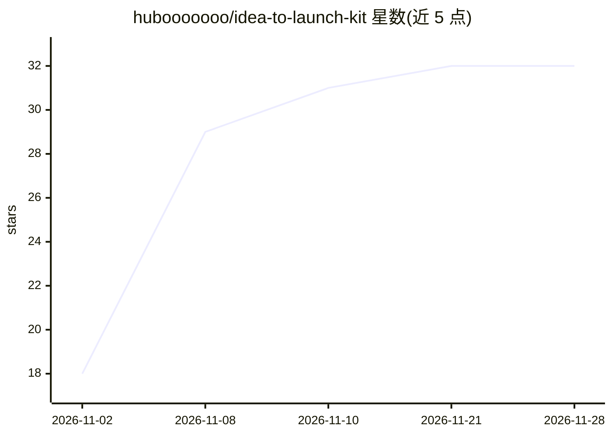

# hubooooooo/idea-to-launch-kit

⭐ 32 · Shell · MIT · 推送 2026-11-18 · [GitHub](https://github.com/hubooooooo/idea-to-launch-kit) · 个人维护 · 中文 README

**非技术者用编码 AI 从想法做到上线的开发工具包**

一个装着规则卡（AGENTS.md）、三份技术手册与自检脚本（verify.sh、kit.sh）的项目模板：用户用 Claude Code、Codex、Pi 等编码 AI 工具打开文件夹并贴启动句，AI 按六阶段流程写代码、做界面、部署到腾讯云开发，用户只做业务判断与验收。每阶段强制交证据包，六项由脚本判定而非 AI 自述。面向不懂代码的产品经理和学生，仅支持 Mac，仅适合网页形态 MVP（同时在线几十人以内），不支持 Windows 与对公众正式运营。

## 筛选速览

| 维度 | 判定 | 备注 |
|---|---|---|
| AI 角色 | `ai-ecosystem` | LLM/agent 周边工具 |
| 许可风险 | `permissive` | MIT |
| 部署形态 | `None` |  |
| 模型依赖 | — | README 未给出锁定关系 |
| 硬件要求 | — | 无带数字的原话,不猜 |
| 安装摩擦 | `low` | 无编译、无系统依赖或容器化 |
| 成熟度 | — | 结构信号不足 |

## 能力要点

- 规则卡 + 三份技术手册 + 自检脚本的六阶段开发流程
- 每阶段证据包与 verify.sh 六项脚本化验收（测试/真实模型调用/密钥排除等）
- 规则卡写死底线：密钥不进代码、花钱先报价、真实模型验证
- 不绑定特定编码工具或模型，进度存于文件夹可中途换工具

## 适用场景

- 不会写代码的产品经理或学生把 AI 产品想法做成上线的 MVP
- 让 AI 扮演技术合伙人，自己只做业务判断和验收
- 用脚本核验 AI 每个阶段是否真的完成任务

## 场景标签

`提示工程` · 领域:Agent 开发

## 证据(README 行号)

> L19: 一个装着"规则"的空项目文件夹：一张 AI 规则卡、三份技术手册、一个自检脚本。
> L21: 你用编码 AI 工具打开它，贴一句启动句。AI 就按规则卡扮演你的技术合伙人：先帮你把需求问清楚，再按阶段写代码、做界面、部署上线，每个阶段交证据给你核对。你只做业务判断和少数必须本人做的事（申请 Key、实名认证、确认花钱）。
> L60: 它和网页版聊天 AI 的区别是：能在你电脑上装东西、跑程序、改文件。网页版 AI 做不到，不能用。推荐三个，选一个就行：

## 星数曲线

2026-11-02 18 → 2026-11-28 32（+14）

---
*卡片 v1 · prompt 1.4 · 生成 2026-11-18 · 置信度 high · 依据 README sha `c80e3a9ab97d` · [字段定义](../../DATASET.md)*
