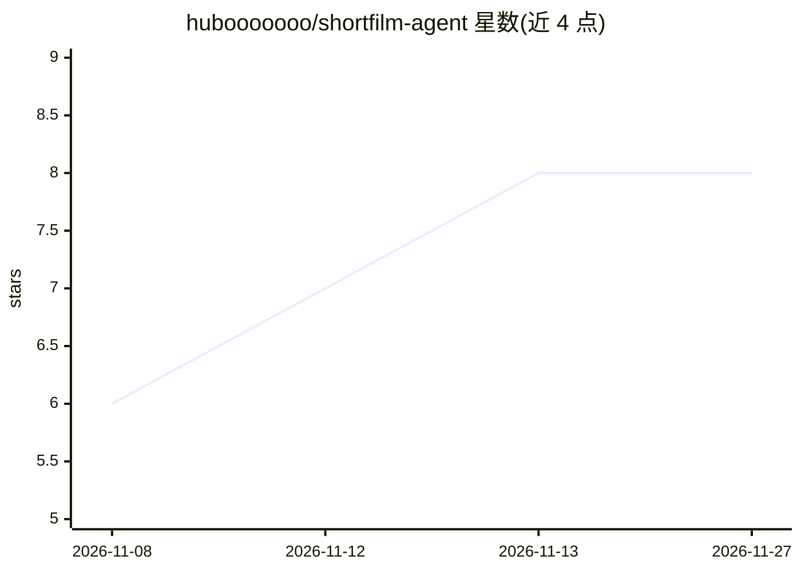

# hubooooooo/shortfilm-agent

⭐ 8 · Python · NOASSERTION · 推送 2026-11-06 · [GitHub](https://github.com/hubooooooo/shortfilm-agent) · 个人维护 · 中文 README

**为 AI 产品课程与开发者提供的多场景图像/视频生成流水线底座**

以 FastAPI + Next.js 实现的 AIGC 内容生产底座：用户输入一句需求，系统按场景包拆成多阶段流水线（文案→角色设定→分镜→画面→视频→成片），每阶段产出可确认、修改、单项重生成。内置 AI 短片、电商广告、漫剧、旅游宣传、商品海报 5 个场景，新增场景通常只需复制场景包并改 YAML 与提示词。LLM/图像/视频各环节模型可在多家服务商间切换，密钥统一在 config.yaml 配置；README 定位为课程配套教学项目。

## 筛选速览

| 维度 | 判定 | 备注 |
|---|---|---|
| AI 角色 | `ai-ecosystem` | LLM/agent 周边工具 |
| 许可风险 | `none` | NOASSERTION |
| 部署形态 | `self-host` | docker 或自建部署 |
| 模型依赖 | local-ok | 支持本地模型 |
| 硬件要求 | — | 无带数字的原话,不猜 |
| 安装摩擦 | `low` | 无编译、无系统依赖或容器化 |
| 成熟度 | — | 结构信号不足 |

## 能力要点

- 场景包即产品：一个文件夹一个行业场景，零代码扩展（改 YAML 和提示词）
- 6 种阶段类型的多阶段流水线，人在回路确认/修改/重生成
- 模型可插拔：通义/火山方舟/可灵/OpenAI/Gemini/DeepSeek 及任意 OpenAI 兼容接口
- 提供一键安装脚本、Docker Compose、30 分钟场景开发教程与二次开发指南

## 适用场景

- 为电商、旅游等行业用底座生成短视频或海报内容
- 课程中学习如何基于同一引擎组合阶段做出不同 AIGC 产品
- 为自有品牌替换模型服务商并深度二次开发

## 场景标签

`AI 写作` `图像生成` `视频生成` `教程课程` · 领域:内容生成

## 证据(README 行号)

> L3:  AIGC 内容生产 Agent 底座：一套流程引擎，适配不同行业的图像 / 视频生成产品
> L13: ShortFilm Agent 是一个**可二次开发的 AIGC 项目底座**。用户输入一句需求，系统把它拆成一条多阶段的生产流水线，每个阶段的产出都可以**查看、确认、修改、单项重新生成**，人始终在回路里。
> L24: - 🔌 **模型可插拔** —— 通义 / 火山方舟 / 可灵 / OpenAI / Gemini / DeepSeek 任意切换
> L63: 这个项目是为「基于底座做行业 AIGC 产品」的课程准备的。建议这样使用：

## 星数曲线

2026-11-08 6 → 2026-11-27 8（+2）

---
*卡片 v1 · prompt 1.4 · 生成 2026-11-20 · 置信度 high · 依据 README sha `281e6d1a2e16` · [字段定义](../../DATASET.md)*
