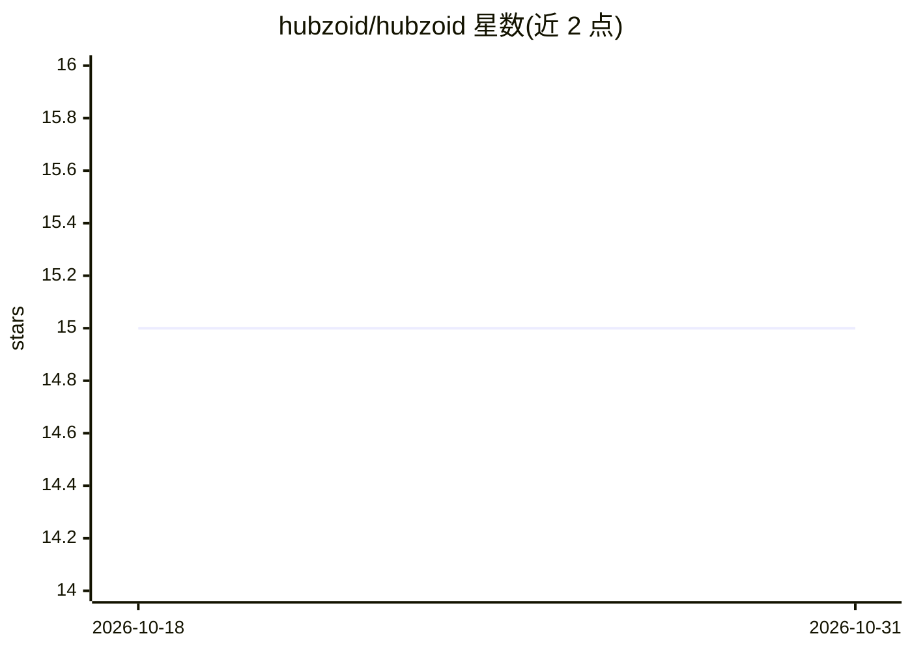

# hubzoid/hubzoid

⭐ 15 · Python · Apache-2.0 · 推送 2026-10-27 · [GitHub](https://github.com/hubzoid/hubzoid) · [官网](https://hubzoid.com) · 组织维护

**开源内部 AI agent 平台：知识规则工具一次定义，多端复用**

将一个文件夹中的知识（Markdown）、规则与工具组织为可共享的 agent hub，供团队以三种方式使用：Web/Slack 聊天问答（附来源文件）、按需或定时运行的 Python/Markdown 工作流、以及通过 MCP 接入 Claude Code、ChatGPT、Codex 等已有助手。运行时复用本机已登录的 Claude Code 或 Codex，也可改用模型 API key。以 pip 包提供（含 Web UI），支持 Docker/Compose、systemd、Railway 等部署，带团队登录、按人/agent 授权、操作审批与运行记录。知识仅来自文件，聊天中的纠正不会自动保存。

## 筛选速览

| 维度 | 判定 | 备注 |
|---|---|---|
| AI 角色 | `ai-ecosystem` | LLM/agent 周边工具 |
| 许可风险 | `permissive` | Apache-2.0 |
| 部署形态 | `self-host` | docker 或自建部署 |
| 模型依赖 | — | README 未给出锁定关系 |
| 硬件要求 | — | 无带数字的原话,不猜 |
| 安装摩擦 | `low` | 无编译、无系统依赖或容器化 |
| 成熟度 | — | 结构信号不足 |

## 能力要点

- 知识/规则以 Markdown 文件存储，可读、可编辑、可用 Git 版本管理
- 同一 hub 支持聊天、定时工作流与 MCP 接入三种使用方式
- 运行时复用已登录的 Claude Code 或 Codex，也可用模型 API key
- 团队功能：登录、按人按 agent 授权、审批、运行记录与部署校验

## 适用场景

- 把团队规则和知识做成一个可问答、可溯源的内部 agent
- 把同一套知识通过 MCP 带入我已在用的 Claude Code 或 Codex
- 定时运行可重复的检查/报告工作流
- 自托管并按人控制访问与审批

## 场景标签

`Agent 框架` `工作流自动化` `聊天机器人` · 领域:Agent 开发

## 证据(README 行号)

> L17: **Hubzoid turns a folder of your knowledge, rules and tools into an agent you can use yourself and share with your 
> L24: - **One hub, three ways to use it.** Ask in **chat**, run repeatable **workflows** on demand or on a schedule, or b
> L97: |Bring the same capabilities into your own assistant|**MCP**, with your own access. Connect your assistant|

## 星数曲线

2026-10-18 15 → 2026-10-31 15（+0）

---
*卡片 v1 · prompt 1.4 · 生成 2026-10-30 · 置信度 high · 依据 README sha `49fceefe17a0` · [字段定义](../../DATASET.md)*
