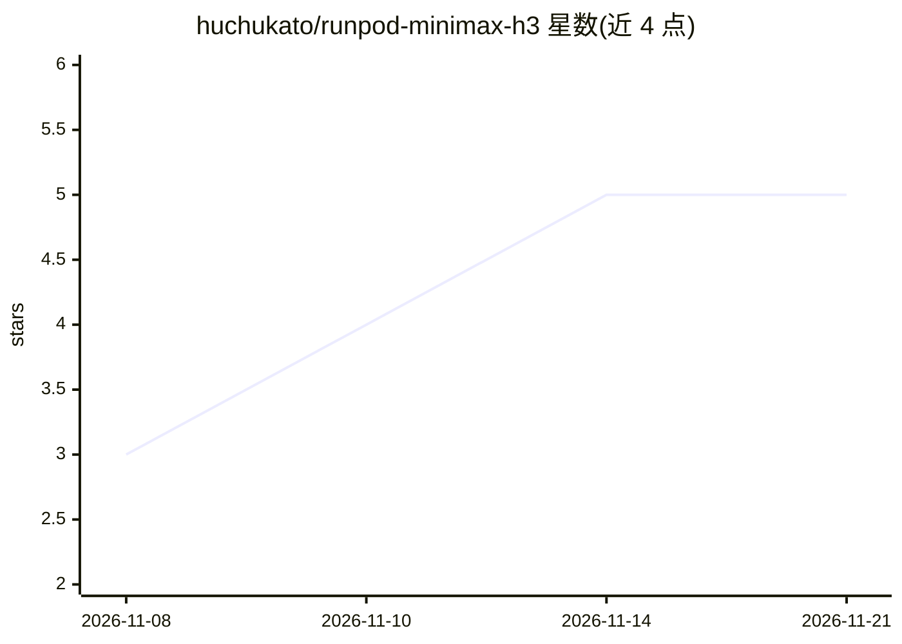

# huchukato/runpod-minimax-h3

⭐ — · [GitHub]() · 个人维护

**在 RunPod 无服务器端点运行 MiniMax H3 生成视频+音频**

将 MiniMax H3 模型部署为 ComfyUI 无服务器 worker 的 RunPod Hub 项目：提供文生视频/图生视频/首尾帧/参考图生成视频（含音频）、多场景分镜（Director 工作流，内置 QwenVL 分析与扩写）、文生图与图像编辑、2 倍视频超分等 8 个工作流。模型约 120GB，需 ≥160GB 网络卷与 96GB 级 GPU，冷启动负担大，建议保持一个热 worker。通过 RunPod API 或配套 ForgeHub 界面调用。

## 筛选速览

| 维度 | 判定 | 备注 |
|---|---|---|
| AI 角色 | `ai-native` | 本体是模型或模型工具 |
| 许可风险 | `none` | — |
| 部署形态 | `None` |  |
| 模型依赖 | — | README 未给出锁定关系 |
| 硬件要求 | — | 无带数字的原话,不猜 |
| 安装摩擦 | `medium` | 含编译或系统依赖之一 |
| 成熟度 | — | 结构信号不足 |

## 能力要点

- 8 个预置工作流：T2VA/I2VA/FL2VA/R2VA、Director 分镜、T2I/图像编辑、2x 超分
- 8-step 蒸馏 turbo 检查点，内置 TensorRT RIFE 与超分后处理链
- Director 工作流通过内置 QwenVL 自动分析主体并扩写创意为多场景分镜
- 模型清单自动下载到网络卷，可通过 VOLUME_AUTOPOPULATE=false 关闭

## 适用场景

- 在 RunPod 无服务器端点按需生成带音频的视频
- 用角色设定与创意清单自动生成多场景分镜
- 对已有视频片段做 2 倍超分
- 文本生成高分辨率静态图或按指令编辑图片

## 场景标签

`视频生成` `图像生成` `图像视频处理` · 领域:内容生成

## 证据(README 行号)

> L7: A production-ready Runpod Serverless worker running **MiniMax H3** (Comfy-Org INT8 ConvRot) on ComfyUI — text/image/
> L25: |`MiniMaxH3-Director-Native.json`|**Director**: character sheet + one idea per line → multi-scene storyboard with a

## 星数曲线

2026-11-08 3 → 2026-11-21 5（+2）

---
*卡片 v1 · prompt 1.4 · 生成 2026-11-21 · 置信度 high · 依据 README sha `b89208f2dca2` · [字段定义](../../DATASET.md)*
