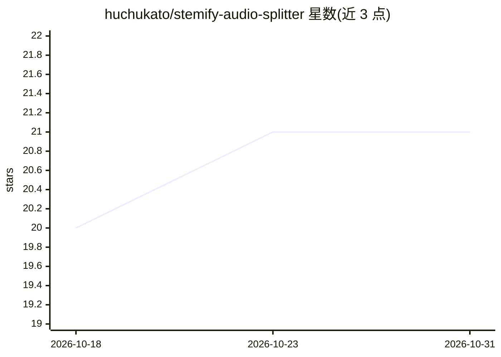

# huchukato/stemify-audio-splitter

⭐ 21 · TypeScript · MIT · 推送 2026-10-16 · [GitHub](https://github.com/huchukato/stemify-audio-splitter) · 个人维护

**AI 音轨分离工具：把歌曲拆成人声、鼓、贝斯等分轨**

基于 Facebook Research Demucs v4（htdemucs）模型的音乐分轨工具，将音频拆分为人声、鼓、贝斯与伴奏，同时用 librosa 自动检测 BPM 与调性并嵌入文件名。提供 Electron 桌面应用（捆绑 PyInstaller Python 后端，模型约 84 MB 首次运行自动下载）与自托管 Web 应用两种形态，支持 Apple Silicon Metal 加速并自动回退 CPU，附带历史分轨库、交互波形播放器、ZIP 打包下载及 AbletonMCP 集成（由 Claude Desktop、Cursor、Devin 等 AI 助手控制 Ableton）。Web 版需 Python 3.12+、uv 与 Node.js 18+，通过安装脚本或手动命令运行；Web 界面上传限制为 20 MB。

## 筛选速览

| 维度 | 判定 | 备注 |
|---|---|---|
| AI 角色 | `ai-native` | 本体是模型或模型工具 |
| 许可风险 | `permissive` | MIT |
| 部署形态 | `desktop` | 安装包/桌面程序 |
| 模型依赖 | — | README 未给出锁定关系 |
| 硬件要求 | — | 无带数字的原话,不猜 |
| 安装摩擦 | `low` | 无编译、无系统依赖或容器化 |
| 成熟度 | — | 结构信号不足 |

## 能力要点

- Demucs v4 (htdemucs) 模型分轨为人声/鼓/贝斯/伴奏
- 自动 BPM 与调性检测并嵌入文件名
- Electron 桌面应用（macOS/Windows 安装包）与自托管 Web 应用双形态
- AbletonMCP 集成，可由 AI 助手控制 Ableton 编曲

## 适用场景

- 把自己喜欢的歌曲拆成 stems 用于 remix 或采样
- 制作人把分轨导入 Ableton 并用 AI 助手辅助编曲
- 快速获取歌曲的伴奏或人声音轨

## 场景标签

 · 领域:音乐/音频处理

## 证据(README 行号)

> L12: Split any song into **vocals, drums, bass and instrumental** with AI — available as a **desktop app** (macOS, Windo
> L17: - 🎚️ **AI stem separation** — Facebook Research Demucs v4 (htdemucs)

## 星数曲线

2026-10-18 20 → 2026-10-31 21（+1）

---
*卡片 v1 · prompt 1.4 · 生成 2026-10-28 · 置信度 mid · 依据 README sha `bf6d5ebdca8f` · [字段定义](../../DATASET.md)*
