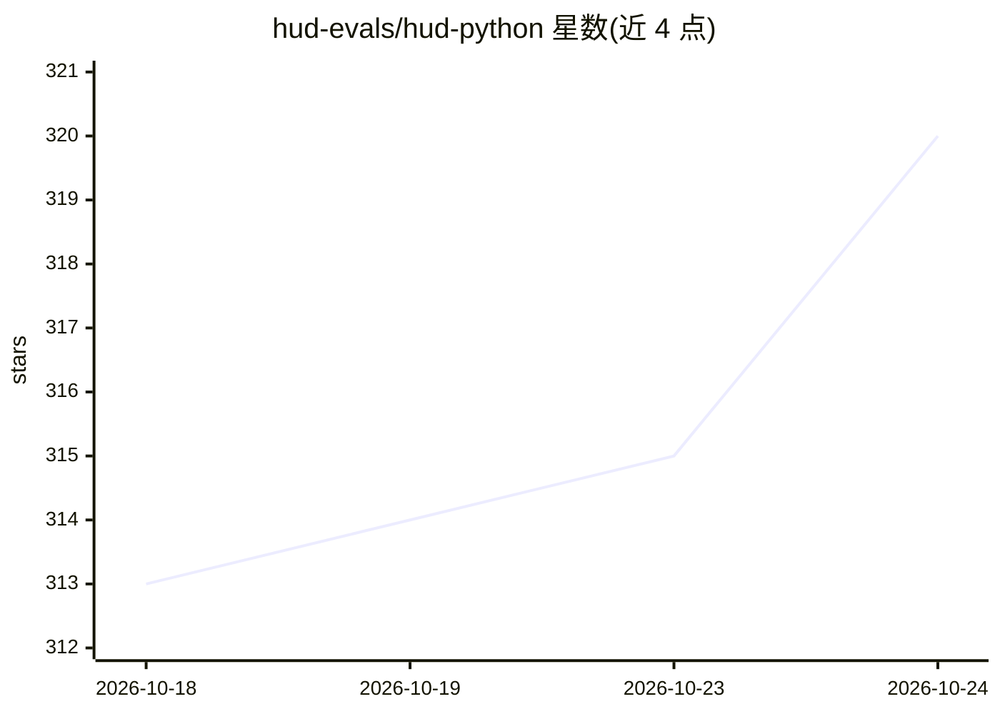

# hud-evals/hud-python

⭐ 320 · Python · MIT · 推送 2026-10-24 · [GitHub](https://github.com/hud-evals/hud-python) · [官网](https://www.hud.ai) · 组织维护

**AI agent 的 RL 环境与评测平台：一次定义，跨模型训练评测**

面向构建 AI agent 的 RL 环境与评测平台，覆盖编程、浏览器、计算机操作与机器人场景。以协议为核心：环境与 agent 间仅交换 manifest、tasks.start 与 tasks.grade，同一环境可服务任意模型与 harness。环境以 async 生成器模板定义，构建为容器镜像后经 hud deploy 注册、hud eval 远程运行；每次 rollout 返回带 trace_id 与 reward 的 Run，可直接作为 GRPO/PPO 训练数据。原生支持 Claude、OpenAI、Gemini 等 harness，需 HUD API key 使用平台功能。

## 筛选速览

| 维度 | 判定 | 备注 |
|---|---|---|
| AI 角色 | `ai-ecosystem` | LLM/agent 周边工具 |
| 许可风险 | `permissive` | MIT |
| 部署形态 | `library` | 以包/库形式分发 |
| 模型依赖 | locked-api |  |
| 硬件要求 | — | 无带数字的原话,不猜 |
| 安装摩擦 | `low` | 无编译、无系统依赖或容器化 |
| 成熟度 | — | 结构信号不足 |

## 能力要点

- manifest/start/grade 三要素协议，任意模型与 harness 接入同一环境
- ssh/mcp/cdp/rfb/robot 五类能力连接，支持 shell、浏览器、计算机操作与机器人
- rollout 返回 trace 与 reward，评测任务可直接作为 GRPO/PPO 训练数据
- uv/pip 安装 CLI 或库，hud init 从模板创建环境

## 适用场景

- 为编程、浏览器、计算机使用 agent 定义统一的评测任务集
- 在同一任务集上对比不同模型的 rollout 表现
- 把评测环境直接接入自有的 GRPO/PPO 训练循环

## 场景标签

`模型评测` `强化学习` · 领域:评测与运维

## 证据(README 行号)

> L3: HUD is a platform for building RL environments for AI agents, across coding, browser, computer-use, and robotics. De
> L136: HUD is the environment-and-reward source for your own GRPO/PPO loop — the same environment trains any model, text 

## 星数曲线

2026-10-18 313 → 2026-10-24 320（+7）

---
*卡片 v1 · prompt 1.4 · 生成 2026-10-22 · 置信度 high · 依据 README sha `94a4c0ef26f6` · [字段定义](../../DATASET.md)*
