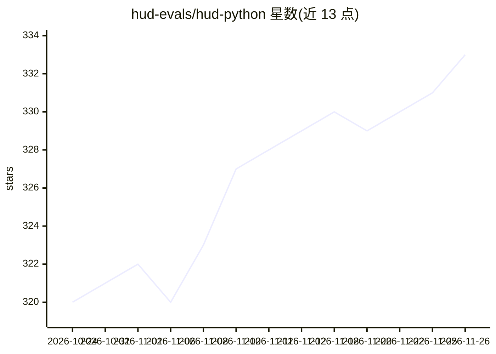

# hud-evals/hud-python

⭐ 333 · Python · MIT · 推送 2026-11-25 · [GitHub](https://github.com/hud-evals/hud-python) · [官网](https://www.hud.ai) · 组织维护

**为 AI agent 构建强化学习环境与评测的平台 SDK/CLI**

HUD 提供构建 agent 强化学习环境与评测的工具：以协议优先方式定义环境（manifest、tasks.start 返回 prompt、tasks.grade 返回奖励），通过模板函数生成任务数据集，用 CLI 打包部署并在任意模型上运行评测，每次评测记录为 trace。环境通过 ssh/mcp/cdp/rfb 四种能力暴露 shell、工具、浏览器与计算机操作接口，harness 在运行时接入所选模型。SDK 与 CLI 经 PyPI 安装，评测记录托管于 hud.ai 平台。

## 筛选速览

| 维度 | 判定 | 备注 |
|---|---|---|
| AI 角色 | `ai-ecosystem` | LLM/agent 周边工具 |
| 许可风险 | `permissive` | MIT |
| 部署形态 | `library` | 以包/库形式分发 |
| 模型依赖 | — | README 未给出锁定关系 |
| 硬件要求 | — | 无带数字的原话,不猜 |
| 安装摩擦 | `low` | 无编译、无系统依赖或容器化 |
| 成熟度 | — | 结构信号不足 |

## 能力要点

- 协议优先：manifest + tasks.start + tasks.grade 三要素衔接 agent 与环境
- ssh/mcp/cdp/rfb 四种能力接口覆盖 shell、工具、浏览器与 computer-use
- 原生接入 Claude、OpenAI、OpenAI 兼容端点与 Gemini，可自封装 harness
- hud deploy 一步构建并注册环境，hud eval 支持本地与远程运行

## 适用场景

- 为编码/浏览器/计算机操作类 agent 定义可复用的 RL 环境与任务集
- 在同一任务集上批量评测并对比多个模型
- 训练时生成带奖励评分的 rollout（GRPO 等强化学习流程）

## 场景标签

`模型评测` `强化学习` · 领域:评测与运维

## 证据(README 行号)

> L3: HUD is a platform for building RL environments for AI agents, across coding, browser, and computer-use. Define an en
> L46: HUD is **protocol-first**. An agent and an environment exchange just three things: a **manifest** (the environment'
> L101: **Ships natively:** Claude, OpenAI (Responses), OpenAI-compatible endpoints, and Gemini via `create_agent("claude-

## 星数曲线

2026-10-24 320 → 2026-11-26 333（+13）

---
*卡片 v1 · prompt 1.4 · 生成 2026-11-25 · 置信度 high · 依据 README sha `508bd3d3baa4` · [字段定义](../../DATASET.md)*
