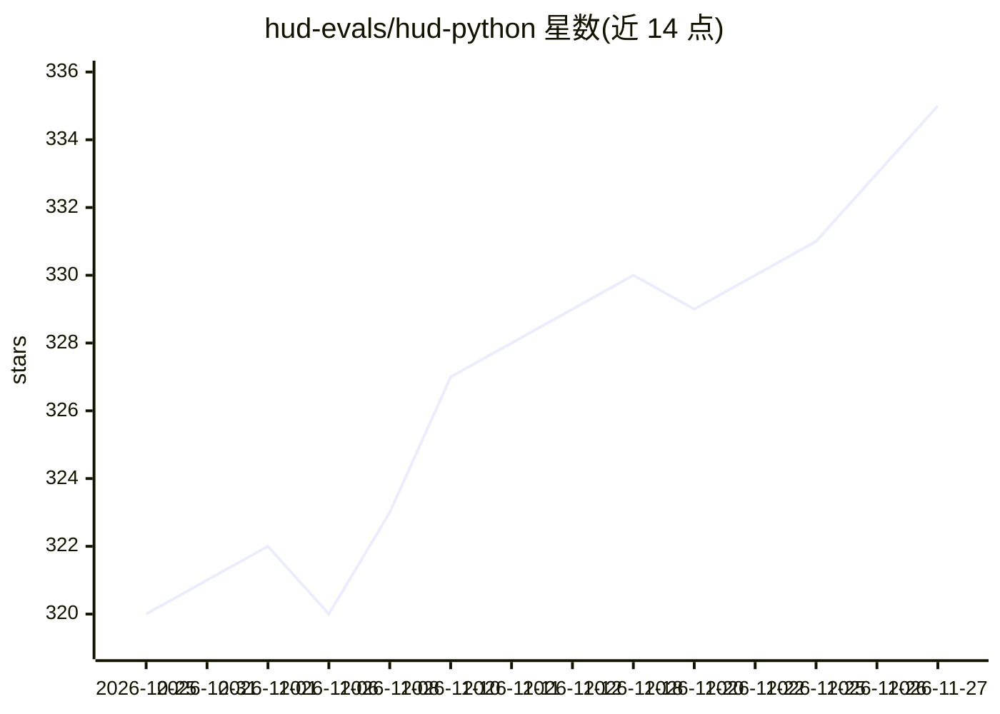

# hud-evals/hud-python

⭐ 335 · Python · MIT · 推送 2026-11-26 · [GitHub](https://github.com/hud-evals/hud-python) · [官网](https://www.hud.ai) · 组织维护

**为 AI agent 构建 RL 环境与评测的平台**

HUD 提供一个协议优先的平台，用于为 AI agent 构建 RL 环境与评测，覆盖编码、浏览器与 computer-use 场景。核心机制是环境与 agent 之间仅交换 manifest、tasks.start（返回提示）与 tasks.grade（返回奖励）三件事，环境只暴露能力（ssh/mcp/cdp/rfb），任何 harness 或模型均可接入同一环境。任务以异步生成器模板定义，构建的镜像即任务产品，可经 hud deploy 部署到平台远程运行与对比。使用需在 hud.ai 获取 API key。

## 筛选速览

| 维度 | 判定 | 备注 |
|---|---|---|
| AI 角色 | `ai-ecosystem` | LLM/agent 周边工具 |
| 许可风险 | `permissive` | MIT |
| 部署形态 | `library` | 以包/库形式分发 |
| 模型依赖 | locked-api |  |
| 硬件要求 | — | 无带数字的原话,不猜 |
| 安装摩擦 | `low` | 无编译、无系统依赖或容器化 |
| 成熟度 | — | 结构信号不足 |

## 能力要点

- 协议优先：manifest + tasks.start + tasks.grade 的薄封装协议
- 四种能力协议：ssh、mcp、cdp（浏览器）、rfb（VNC computer-use）
- 原生气 harness：Claude、OpenAI、OpenAI 兼容端点、Gemini，可自带 harness
- hud deploy 一步构建并注册环境，评测 trace 记录在 hud.ai

## 适用场景

- 为编码或 computer-use agent 搭建可复用的 RL 训练环境
- 在同一任务集上批量评测并对比多个模型
- 通过模板函数生成覆盖整个数据集的任务变体

## 场景标签

`模型评测` `强化学习` · 领域:评测与运维

## 证据(README 行号)

> L3: HUD is a platform for building RL environments for AI agents, across coding, browser, and computer-use. Define an en
> L46: HUD is **protocol-first**. An agent and an environment exchange just three things: a **manifest** (the environment'
> L101: **Ships natively:** Claude, OpenAI (Responses), OpenAI-compatible endpoints, and Gemini via `create_agent("claude-

## 星数曲线

2026-10-25 320 → 2026-11-27 335（+15）

---
*卡片 v1 · prompt 1.4 · 生成 2026-11-26 · 置信度 high · 依据 README sha `9a77287c7d43` · [字段定义](../../DATASET.md)*
