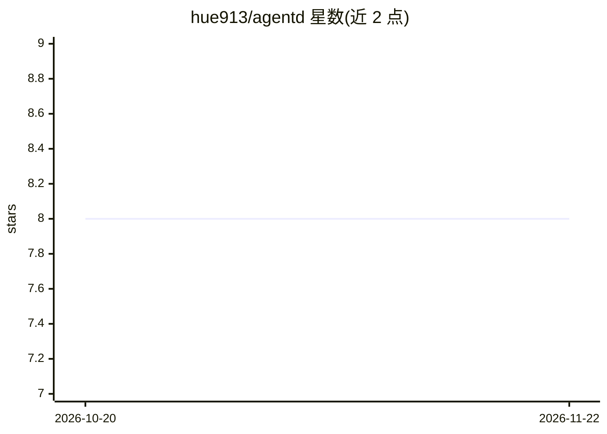

# hue913/agentd

⭐ — · [GitHub]() · 个人维护

**自托管多模型 agent 服务器：LLM 经 SSH 操作你的主机并留存经验记忆**

自托管的 agent 服务器，让用户将任意 OpenAI 兼容端点或原生 Anthropic/Gemini 模型接入服务器运维：模型通过 SSH、shell、文件等真实工具执行操作，危险命令经安全门等待人工点击批准。核心机制为 JitRL 经验记忆——将 (state, action, return) 三元组存入 SQLite 并检索复用，无需训练或 GPU。提供浏览器控制台与 Tauri 桌面客户端两种界面，多模型议会以独立提案、交叉质询和裁决方式决策，全程记录可回放的轨迹。

## 筛选速览

| 维度 | 判定 | 备注 |
|---|---|---|
| AI 角色 | `ai-ecosystem` | LLM/agent 周边工具 |
| 许可风险 | `permissive` | — |
| 部署形态 | `library` | 以包/库形式分发 |
| 模型依赖 | locked-api |  |
| 硬件要求 | — | 无带数字的原话,不猜 |
| 安装摩擦 | `low` | 无编译、无系统依赖或容器化 |
| 成熟度 | — | 结构信号不足 |

## 能力要点

- JitRL 经验记忆：动作结果存 SQLite，n-gram 检索复用，无需训练与 GPU
- 多模型议会：独立提案→边界内交叉质询→裁决，保留异议不做假共识
- 安全门：rm -rf、mkfs、DROP TABLE 等命令需人工批准才执行
- Tauri 桌面客户端（macOS/Windows）与浏览器控制台共用同一 API

## 适用场景

- 让 LLM 通过 SSH 排查和运维自己的服务器（如 nginx 故障）
- 以 $5 VPS 低成本运行 agent 而不暴露公网端口
- 对比有/无记忆的基准评测，验证记忆机制收益
- 用可回放轨迹审计 agent 每一步的提案与批准记录

## 场景标签

`Agent 框架` `多智能体` `浏览器自动化` `Agent 记忆` · 领域:Agent 开发

## 证据(README 行号)

> L9: 1. **Put LLMs to work on your servers.** Point it at any model — an OpenAI-compatible
> L76: |**An agent loop that acts**|open goals (`kind:"ops"`) run through the tool bus: the model proposes real calls — `s
> L79: |**Multi-model councils**|independent proposals → cross-examination under a boundary → adjudication. Dissent is ren

## 星数曲线

2026-10-20 8 → 2026-11-22 8（+0）

---
*卡片 v1 · prompt 1.4 · 生成 2026-11-20 · 置信度 high · 依据 README sha `b5388fc0e859` · [字段定义](../../DATASET.md)*
