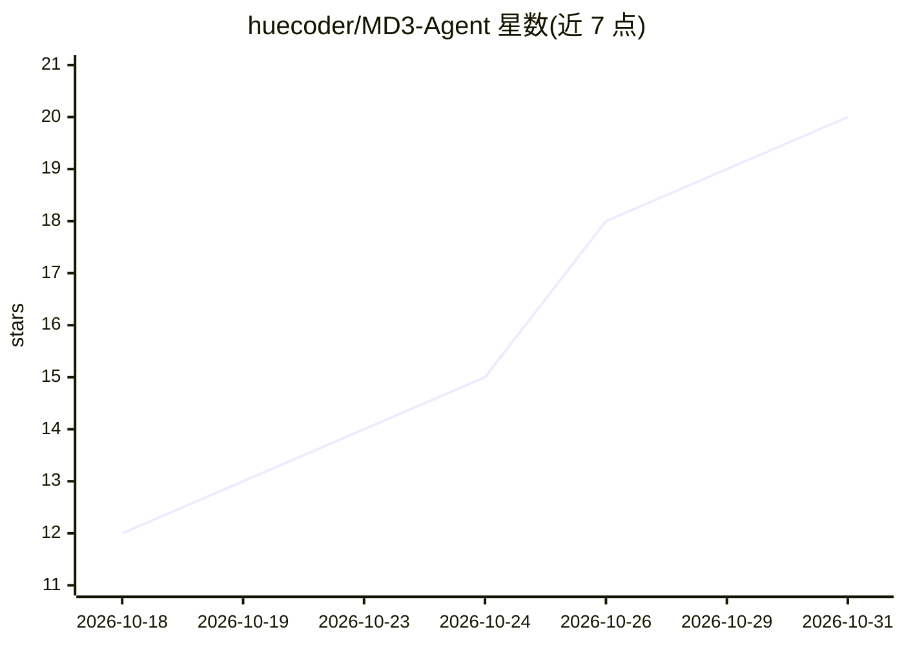

# huecoder/MD3-Agent

⭐ 20 · Kotlin · GPL-3.0 · 推送 2026-10-22 · [GitHub](https://github.com/huecoder/MD3-Agent) · 个人维护

**开源 Android 手机 AI 助手应用：自带 API key 读屏控机**

Kotlin/Jetpack Compose 编写的 Android 端 LLM 助手客户端，定位为 Gemini 助手的开源替代。用户自选模型提供商（OpenAI 兼容、Anthropic Messages、Google Gemini 三种 API 格式，自定义 base URL），无后端、无账号、无遥测，密钥经 Android Keystore 加密，聊天存本地数据库。提供 29 个内置工具与 MCP 服务器接入，可通过无障碍服务读屏并代用户操作其他应用，也支持运行 Python 脚本与 Shell 命令。当前版本 0.8。以 APK 安装包分发，需 Android 10 及以上 arm64 设备。

## 筛选速览

| 维度 | 判定 | 备注 |
|---|---|---|
| AI 角色 | `ai-native` | 本体是模型或模型工具 |
| 许可风险 | `viral` | GPL-3.0 |
| 部署形态 | `None` |  |
| 模型依赖 | local-ok | 支持本地模型 |
| 硬件要求 | — | 无带数字的原话,不猜 |
| 安装摩擦 | `low` | 无编译、无系统依赖或容器化 |
| 成熟度 | `idea` | |

## 能力要点

- 三种原生 API 格式（OpenAI 兼容/Anthropic/Gemini）与自定义 base URL
- 29 个内置工具 + MCP 服务器，工具按 Off/Ask/Auto 三档授权
- 无障碍服务读屏与代操作其他应用
- 纯客户端：无后端、无遥测、密钥 Android Keystore 加密

## 适用场景

- 在手机上用自己的 API key 运行多模型 AI 助手
- 让 AI 读屏并代为点击、输入、操作其他应用
- 通过手势唤起助手在任意应用上方对话
- 用 MCP 服务器扩展助手能力

## 场景标签

`AI 助手` `GUI 自动化` · 领域:效率与自动化

## 证据(README 行号)

> L24: MD3 Agent talks to the model provider you choose and hands the model a set of tools. Ask it to check the weather, r
> L26: It is only a client. There is no backend, no sign-up and no telemetry. Chats live in a local database, API keys are

## 星数曲线

2026-10-18 12 → 2026-10-31 20（+8）

---
*卡片 v1 · prompt 1.4 · 生成 2026-10-28 · 置信度 high · 依据 README sha `b46dc672023b` · [字段定义](../../DATASET.md)*
