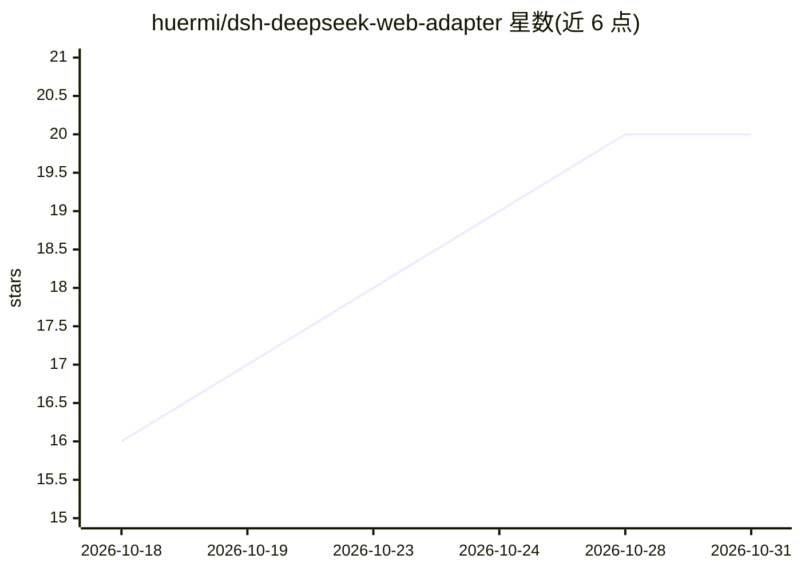

# huermi/dsh-deepseek-web-adapter

⭐ 20 · JavaScript · MIT · 推送 2026-08-15 · [GitHub](https://github.com/huermi/dsh-deepseek-web-adapter) · 个人维护 · 中文 README

**把 DeepSeek 网页版变成 DSH 免 API Key 模型提供方的插件**

面向 DeepSeek Harness（DSH）的插件：把 chat.deepseek.com 网页版封装为本地网关，对外提供 OpenAI 兼容 API，无需 API Key（只需登录自己的 DeepSeek 账号）。插件加载时自动拉起网关（Node 18+ 与本机 Chrome），卸载即回收。通过提示工程与多层容错解析把模型输出的 tool_call 代码块转为标准 tool_calls，支持连续对话、模型校准、子 agent 并发。处于开发者预览阶段，多轮工具循环、长对话迁移等未充分验证，且依赖 DeepSeek 网页版 UI，改版可能导致选择器失效。

## 筛选速览

| 维度 | 判定 | 备注 |
|---|---|---|
| AI 角色 | `ai-ecosystem` | LLM/agent 周边工具 |
| 许可风险 | `permissive` | MIT |
| 部署形态 | `None` |  |
| 模型依赖 | locked-api |  |
| 硬件要求 | — | 无带数字的原话,不猜 |
| 安装摩擦 | `low` | 无编译、无系统依赖或容器化 |
| 成熟度 | `idea` | |

## 能力要点

- chat.deepseek.com 网页版封装为 OpenAI 兼容本地网关（5688 端口）
- 无需 API Key，dsh plugin add 一条命令安装，网关自动拉起/回收
- 提示工程 + 54 场景容错解析实现工具调用
- 连续对话超限自动迁移+摘要，子 agent 并发用独立页面

## 适用场景

- 在 DSH 中免 API Key 使用 DeepSeek 网页版模型
- 在 DeepSeek Harness 里调用工具与多 agent 并发任务
- 不想申请 API 密钥时用网页账号跑本地兼容网关

## 场景标签

`模型网关` · 领域:Agent 开发

## 证据(README 行号)

> L10: 把 **DeepSeek 网页版（chat.deepseek.com）** 变成 DSH 的免 API Key 模型提供方。
> L11: 插件加载后自动拉起本地网关（`resources/dsweb-gateway.js` + `driver.js`，单一常驻浏览器），

## 星数曲线

2026-10-18 16 → 2026-10-31 20（+4）

---
*卡片 v1 · prompt 1.4 · 生成 2026-10-28 · 置信度 high · 依据 README sha `beb4fdad4dc4` · [字段定义](../../DATASET.md)*
