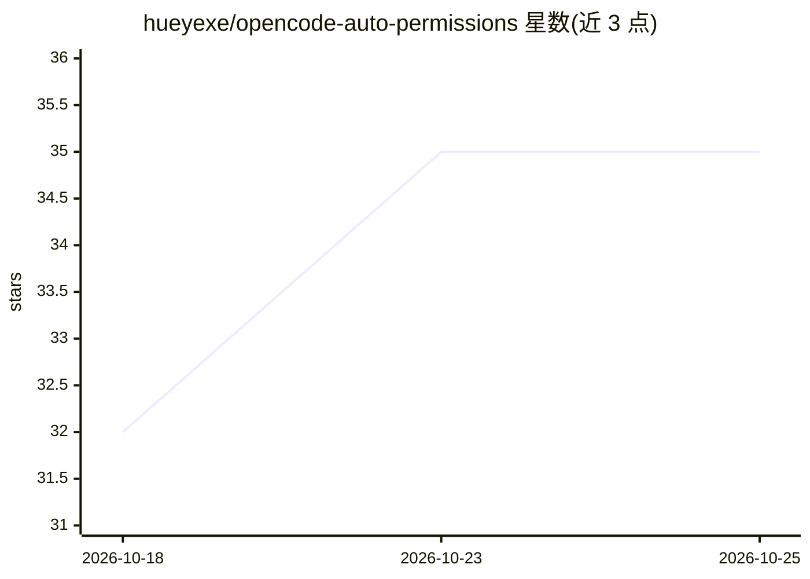

# hueyexe/opencode-auto-permissions

⭐ 35 · TypeScript · MIT · 推送 2026-09-17 · [GitHub](https://github.com/hueyexe/opencode-auto-permissions) · 个人维护

**OpenCode 插件：用模型自动审查权限请求，无人值守时代理不停摆**

面向 OpenCode 编码代理的权限审查插件：将配置为 ask 的权限请求交给一个隔离的单步审查模型判定，结合确定性安全规则（明确禁止、灾难性删除直接拒绝）与上下文风险评估（sudo、删除、force push、部署、凭证访问等）。审查会话无工具、无权限、用后即删；支持会话内模式化复批、专用审查模型与 fallback、shadow 观察模式和 JSONL 诊断日志。通过 opencode plugin add 安装，兼容 stable 与 V2 协议，从不授予永久 always 权限。

## 筛选速览

| 维度 | 判定 | 备注 |
|---|---|---|
| AI 角色 | `ai-ecosystem` | LLM/agent 周边工具 |
| 许可风险 | `permissive` | MIT |
| 部署形态 | `library` | 以包/库形式分发 |
| 模型依赖 | — | README 未给出锁定关系 |
| 硬件要求 | — | 无带数字的原话,不猜 |
| 安装摩擦 | `low` | 无编译、无系统依赖或容器化 |
| 成熟度 | — | 结构信号不足 |

## 能力要点

- ask 权限请求由隔离的单步审查模型判定，明确禁止与灾难性删除不经模型直接拒绝
- 审查会话无工具、无权限，判定后即删除，仅发送少量近期用户上下文
- allow_session 模式化复批带代码侧防护，高危操作强制一次性判定
- shadow 模式可先观察判定行为再启用自动回复，debug 输出隐私最小化的 JSONL 诊断

## 适用场景

- 无人值守时让编码代理自主运行而风险操作仍受审查
- 按风险配置 bash/文件等权限规则，仅对上下文敏感操作触发模型审查
- 在启用自动回复前用 shadow 模式评估插件行为

## 场景标签

 · 领域:开发者工具/AI Agent 安全

## 证据(README 行号)

> L10: Automatic, context-aware permission review for OpenCode. Let routine work run normally, send riskier actions to a r
> L65: For each supported permission request, Auto Permissions combines deterministic safety rules with an isolated, one-s

## 星数曲线

2026-10-18 32 → 2026-10-25 35（+3）

---
*卡片 v1 · prompt 1.4 · 生成 2026-10-25 · 置信度 high · 依据 README sha `65e365fe46db` · [字段定义](../../DATASET.md)*
