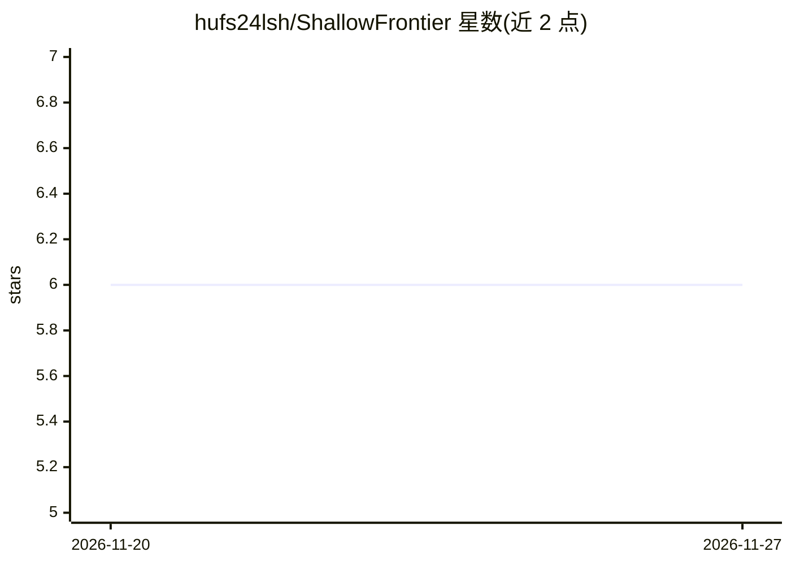

# hufs24lsh/ShallowFrontier

⭐ 6 · Python · MIT · 推送 2026-11-22 · [GitHub](https://github.com/hufs24lsh/ShallowFrontier) · 组织维护

**面向 LLM 微调的低能耗数据选择方法实现（研究代码）**

ShallowFrontier 是一个用于指令微调的 label-free 数据选择方法的开源实现：从指令池中选取 10% 数据用于全量微调，仅做一次浅层校准，从 prompt 的梯度噪声尺度读取各组的训练阶段并按 B/b 边界分配两条选择路由，无需领域标签或参考答案。README 报告了四个测试床（Qwen2.5-7B/Llama-3-8B 的数学、医学及混合池）的分数与端到端 GPU 能耗（NVML 测量），提供 scripts/train.py、grouping.py、noise.py、selection.py 等代码与 seed-42 结果表。MIT 许可，Python 3.10+。

## 筛选速览

| 维度 | 判定 | 备注 |
|---|---|---|
| AI 角色 | `ai-native` | 本体是模型或模型工具 |
| 许可风险 | `permissive` | MIT |
| 部署形态 | `library` | 以包/库形式分发 |
| 模型依赖 | local-ok | 支持本地模型 |
| 硬件要求 | — | 无带数字的原话,不猜 |
| 安装摩擦 | `medium` | 含编译或系统依赖之一 |
| 成熟度 | — | 结构信号不足 |

## 能力要点

- 一次校准替代多轮 calibrate→select→train，按梯度噪声尺度 B 分组分配选择路由
- label-free：仅用 base 模型 prompt 特征的余弦 k-means 分组，97–99% 纯度
- 报告含选择计算在内的端到端 GPU 能耗（NVML 测量）
- 发布代码可从保存的分数与特征字节级复现 15 个选择与 17 个校准子集

## 适用场景

- 在指令微调前从数据池中选取子集以降低训练能耗
- 在数学+医学混合池中保持各领域不被饿死的数据配比
- 复现论文中的数据选择与能耗对比实验

## 场景标签

`微调` · 领域:训练与推理

## 证据(README 行号)

> L38: ShallowFrontier selects 10% of an instruction-tuning pool for full fine-tuning. Instead of the repeated calibration
> L40: pool from the **prompts alone**, and measures each group's **learning phase**: whether the group's gradient noise s
> L45: |Stage|What it does|Code|

## 星数曲线

2026-11-20 6 → 2026-11-27 6（+0）

---
*卡片 v1 · prompt 1.4 · 生成 2026-11-20 · 置信度 high · 依据 README sha `7b02a833a8ce` · [字段定义](../../DATASET.md)*
