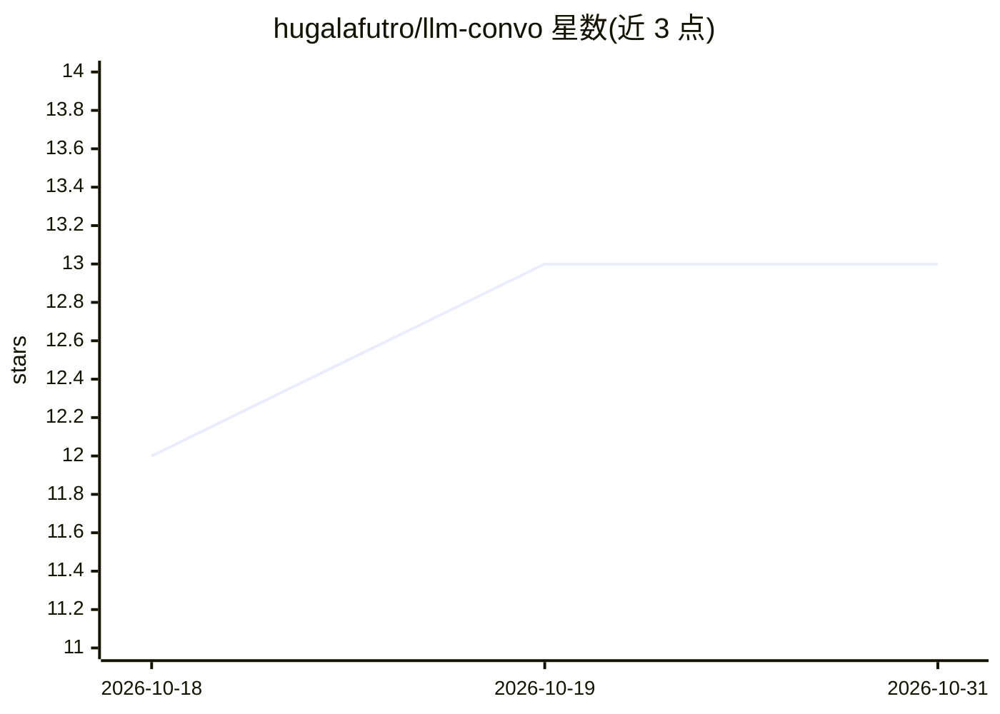

# hugalafutro/llm-convo

⭐ 13 · Python · MIT · 推送 2026-04-01 · [GitHub](https://github.com/hugalafutro/llm-convo) · 个人维护

**让两个 LLM 通过 OpenAI 兼容 API 互相对话的 Web 应用**

小型 Web 应用：两端各接一个 OpenAI 兼容的 chat API 端点（本地或远程均可），设定轮数（1–30 回合）、角色名与可选 system prompt 后，两个模型轮流生成回复，服务器通过 Server-Sent Events 将对话流式推送到浏览器。提供模型选择器、thinking token 折叠显示、每条消息 token 统计、localStorage 本地持久化与 Docker compose 部署。面向想观察两模型对话的普通用户，需自备后端（如 LM Studio、koboldcpp）。作者自述项目主要由 LLM 生成代码，属兴趣实验。

## 筛选速览

| 维度 | 判定 | 备注 |
|---|---|---|
| AI 角色 | `ai-native` | 本体是模型或模型工具 |
| 许可风险 | `permissive` | MIT |
| 部署形态 | `self-host` | docker 或自建部署 |
| 模型依赖 | — | README 未给出锁定关系 |
| 硬件要求 | — | 无带数字的原话,不猜 |
| 安装摩擦 | `low` | 无编译、无系统依赖或容器化 |
| 成熟度 | — | 结构信号不足 |

## 能力要点

- 两端各自连接 OpenAI 兼容端点（URL/API key/角色/系统提示可配）
- 1–30 回合轮次对话，SSE 流式输出，thinking token 折叠显示
- 每条消息附带时间戳、模型 id、token 数与 tokens/s 统计
- Docker compose 部署，含 /health 健康检查

## 适用场景

- 让两个本地或远程模型互相聊天并围观输出
- 对比两个后端模型在同一对话中的表现
- 用各自 system prompt 生成角色开场白再启动对话

## 场景标签

`聊天机器人` · 领域:对话与助手

## 证据(README 行号)

> L5: **LLM Convo** is a small web app that sits between two OpenAI-compatible chat APIs. You connect each side to its own
> L88: I used 2 (later 3) LLMs (Claude Sonnet 3.5 and chatgpt-4o-latest (later locally running Qwen2.5-Coder-7B-Instruct))

## 星数曲线

2026-10-18 12 → 2026-10-31 13（+1）

---
*卡片 v1 · prompt 1.4 · 生成 2026-10-31 · 置信度 high · 依据 README sha `7185e9ab0073` · [字段定义](../../DATASET.md)*
