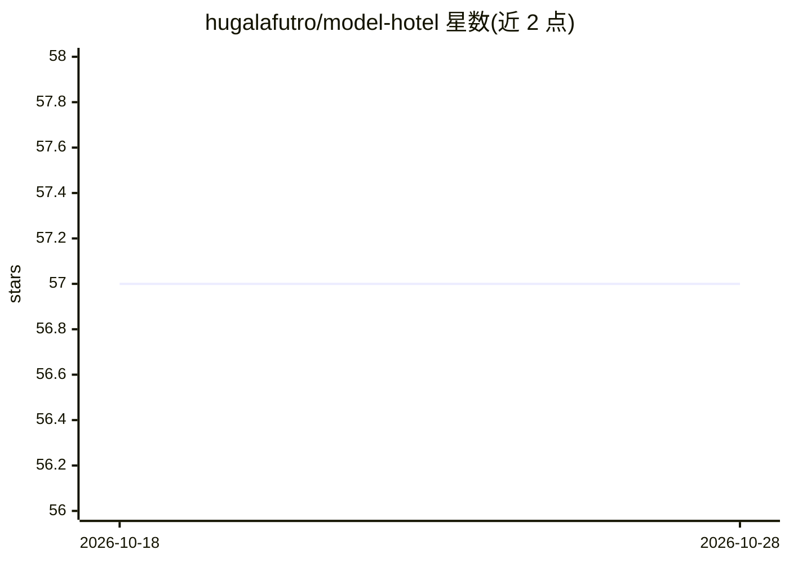

# hugalafutro/model-hotel

⭐ 57 · Go · MIT · 推送 2026-10-28 · [GitHub](https://github.com/hugalafutro/model-hotel) · 个人维护

**多供应商 LLM 网关：统一 OpenAI 兼容端点、自动故障转移**

用 Go/TypeScript/React/PostgreSQL 构建的多供应商 AI 网关：在云端与自托管 LLM 供应商之前提供单一 OpenAI 兼容端点，添加供应商后自动发现模型，同名模型自动组成故障转移组，配额耗尽或故障的供应商按优先级跳过并在恢复后自动回归。支持 hotel/ 前缀路由、按模型熔断、高可用 Front Desk 控制平面与 Traefik 负载均衡、Android 伴侣应用 Bellhop、SHA-256 哈希的虚拟密钥与预算限额。设计上不记录任何用户提示内容，仅记录路由与计量所需元数据。通过 Docker 镜像或 Git 克隆部署。

## 筛选速览

| 维度 | 判定 | 备注 |
|---|---|---|
| AI 角色 | `ai-ecosystem` | LLM/agent 周边工具 |
| 许可风险 | `permissive` | MIT |
| 部署形态 | `self-host` | docker 或自建部署 |
| 模型依赖 | local-ok | 支持本地模型 |
| 硬件要求 | — | 无带数字的原话,不猜 |
| 安装摩擦 | `low` | 无编译、无系统依赖或容器化 |
| 成熟度 | — | 结构信号不足 |

## 能力要点

- 单一 /v1/chat/completions 端点代理 19 家托管供应商与 6 类自托管运行时
- 同名模型自动组成故障转移组，配额重置后自动回归
- 高可用 Front Desk 控制平面 + Traefik 负载均衡 + Bellhop Android 应用
- 虚拟密钥：SHA-256 哈希存储、限速、日/周/月美元预算与供应商访问控制
- 用户提示内容从不被记录，仅记录路由与计量元数据

## 适用场景

- 把多家云端与本地 LLM 供应商统一到一个 OpenAI 兼容端点后使用
- 某供应商配额耗尽或宕机时自动切换到下一家，客户端无需改动
- 给不同用户或服务发放带预算与限额的独立 API 密钥
- 多实例部署网关并从手机监控集群健康状态

## 场景标签

`模型网关` · 领域:Agent 开发

## 证据(README 行号)

> L4:  Multi-Provider AI Gateway
> L27: A single OpenAI-compatible endpoint in front of all your LLM providers, cloud or self-hosted. Add the same model fr
> L40: **Hosted:** Anthropic, AWS Bedrock, Azure AI Foundry, Cohere, DeepSeek, Google AI Studio, Kimi Code, MiniMax, NanoG

## 星数曲线

2026-10-18 57 → 2026-10-28 57（+0）

---
*卡片 v1 · prompt 1.4 · 生成 2026-10-24 · 置信度 high · 依据 README sha `dae2927f43ac` · [字段定义](../../DATASET.md)*
