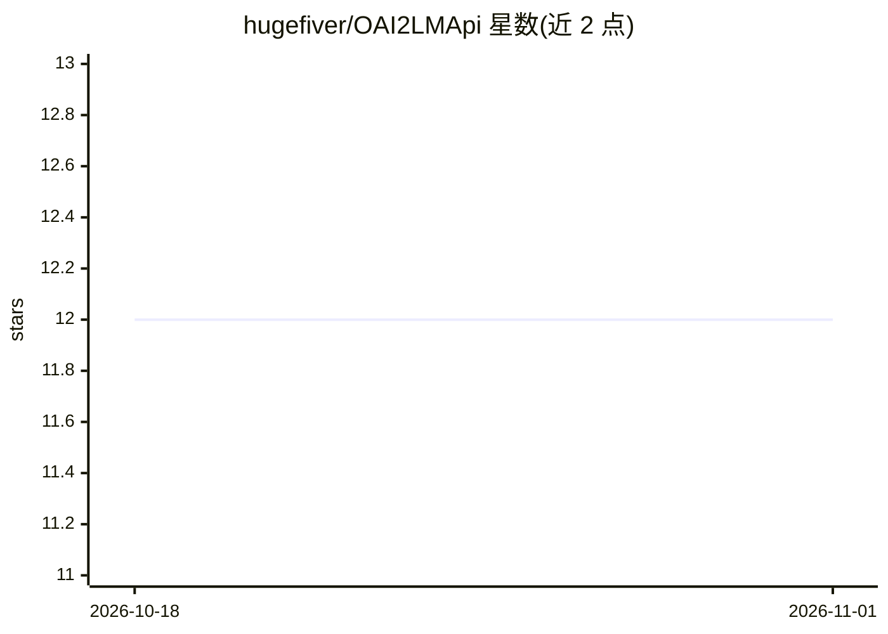

# hugefiver/OAI2LMApi

⭐ 12 · TypeScript · NOASSERTION · 推送 2026-08-16 · [GitHub](https://github.com/hugefiver/OAI2LMApi) · [官网](https://marketplace.visualstudio.com/items?itemName=oai2lmapi.oai2lmapi) · 个人维护

**把 OpenAI 兼容 API 接入 VSCode 语言模型 API 的扩展**

VSCode 扩展：将任意 OpenAI 兼容 API 端点桥接到 VSCode 的 Language Model API，使 GitHub Copilot Chat 及其他 AI 功能可使用自定义端点的模型。支持流式输出、思维链透传、工具调用（含无原生支持模型的 XML 提示回退）、启动时自动加载并缓存模型、按模型覆盖 token 限制等参数；另提供 Gemini 与 Claude 专属通道。API 密钥经 VSCode SecretStorage 存储。要求 VSCode 1.107.0+，从 Marketplace、VSIX 或源码安装。

## 筛选速览

| 维度 | 判定 | 备注 |
|---|---|---|
| AI 角色 | `ai-ecosystem` | LLM/agent 周边工具 |
| 许可风险 | `none` | NOASSERTION |
| 部署形态 | `desktop` | 安装包/桌面程序 |
| 模型依赖 | local-ok | 支持本地模型 |
| 硬件要求 | — | 无带数字的原话,不猜 |
| 安装摩擦 | `low` | 无编译、无系统依赖或容器化 |
| 成熟度 | — | 结构信号不足 |

## 能力要点

- 任意 OpenAI 兼容端点接入 VSCode Language Model API
- Gemini 与 Claude 专属通道（Claude 走 @anthropic-ai/sdk）
- 原生与 XML 提示回退两种工具调用方式
- 按模型/按通道覆盖 token 限制、温度、能力等配置

## 适用场景

- 在 GitHub Copilot Chat 中使用自建或第三方 API 的模型
- 通过 Ollama/vLLM 等本地服务为 VSCode 提供模型
- 为不支持原生工具调用的模型启用提示式工具调用

## 场景标签

 · 领域:开发工具/LLM 接入

## 证据(README 行号)

> L10: A VSCode extension that connects OpenAI-compatible APIs to VSCode's Language Model API, enabling integration with G
> L147: This extension works with any API that implements the OpenAI chat completions format:

## 星数曲线

2026-10-18 12 → 2026-11-01 12（+0）

---
*卡片 v1 · prompt 1.4 · 生成 2026-11-01 · 置信度 mid · 依据 README sha `5e2f3b8cde9a` · [字段定义](../../DATASET.md)*
