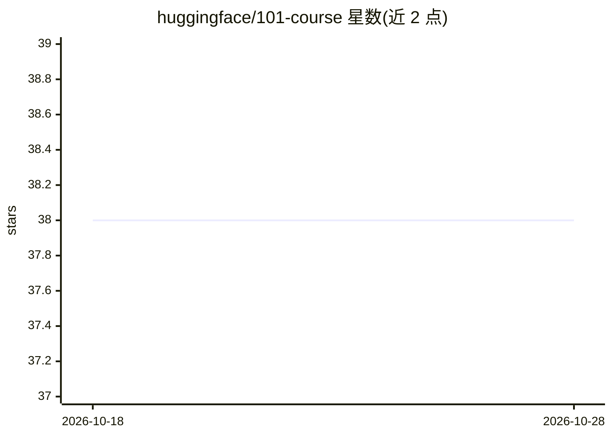

# huggingface/101-course

⭐ 38 · Apache-2.0 · 推送 2026-10-06 · [GitHub](https://github.com/huggingface/101-course) · 组织维护

**Hugging Face 生态实用课程：教学者用 Hub/调试/Gradio**

由 Hugging Face 团队维护的机器学习实用课程仓库，共 4 个章节：环境配置入门、Hugging Face Hub 使用（模型分享与模型卡）、训练管线调试排错、用 Gradio 构建并分享交互式 ML 演示。面向具备基础机器学习概念与 Python 能力的学习者，支持 Google Colab 在线跟学或本地 Python 虚拟环境两种方式，章节内逐步引导安装依赖。前置要求包括 Hugging Face 账号，Git 为可选。

## 筛选速览

| 维度 | 判定 | 备注 |
|---|---|---|
| AI 角色 | `ai-knowledge` | 知识聚合/清单类 |
| 许可风险 | `permissive` | Apache-2.0 |
| 部署形态 | `library` | 以包/库形式分发 |
| 模型依赖 | — | README 未给出锁定关系 |
| 硬件要求 | — | 无带数字的原话,不猜 |
| 安装摩擦 | `low` | 无编译、无系统依赖或容器化 |
| 成熟度 | — | 结构信号不足 |

## 能力要点

- 4 章课程覆盖 Hub、调试排错与 Gradio 演示构建
- 提供 Google Colab 在线学习路径，无需本地环境
- 本地路径给出虚拟环境创建与核心依赖安装命令
- 章节内逐步引导安装各节所需依赖

## 适用场景

- 系统学习 Hugging Face 生态工具的使用
- 学习如何分享模型与编写模型卡
- 入门用 Gradio 为模型构建交互式演示

## 场景标签

`教程课程` · 领域:学习与行业

## 证据(README 行号)

> L3: This is a practical course on using the Hugging Face ecosystem for machine learning. You'll learn how to use the Hug
> L11: This course provides a practical, hands-on approach to working with the Hugging Face ecosystem for machine learning

## 星数曲线

2026-10-18 38 → 2026-10-28 38（+0）

---
*卡片 v1 · prompt 1.4 · 生成 2026-10-25 · 置信度 high · 依据 README sha `e32a204788bc` · [字段定义](../../DATASET.md)*
